# Architecture Flows

[](https://calm.finos.org/)

!!! note "Auto-generated"

    Rendered from `docs/architecture/calm/architecture.json` by the CALM
    CLI (`calm template`). **Do not edit this file by hand** — edit the
    architecture JSON or the Handlebars template at
    `docs/architecture/calm/templates/mermaid/flows.md.hbs` and regenerate
    with `make calm-diagrams`.

Each business flow defined in the CALM architecture is rendered below as
its own Mermaid `flowchart TD` — one diagram per flow, linking the
transitions in sequence order. Three flows are modelled today:

- **Create a VirtualMachine** — the happy path from `kubectl apply` to
  `Ready=true`.
- **Swap a VirtualMachine's backend** — the canonical least-touch
  demonstration: change one field, the controller rebuilds the infra.
- **Delete a VirtualMachine** — finalizer-gated teardown that guarantees
  no backend leaks.


## Create a VirtualMachine

User applies a VirtualMachine CR; the banlieue controller resolves its references and creates a backend-specific infrastructure CR; the matching provider controller observes the infra CR, provisions on its backend, and patches status; the banlieue controller mirrors the status back onto the VirtualMachine.

```mermaid
flowchart TD
    t1["1. VM consumer kubectl-applies a VirtualMachine CR with classRef, imageRef, and (optionally) placement.providerSelector. Persisted in etcd via the management-cluster API server."]
    t2["2. banlieue-controller watch fires. Controller resolves the referenced VMClass and VMImage, matches placement.providerSelector/failureDomainSelector against candidate Provider CRs to pick one, and computes the desired infrastructure spec."]
    t3["3. If VirtualMachine.spec.userData is set, banlieue-controller first reads that Secret or ConfigMap (namespace-scoped Role in banlieue-system, ADR-0025/ADR-0038 — it never gets a cluster-wide Secret grant) and placeholder-substitutes it (ADR-0024's fixed set). It then server-side-applies a VSphereMachine CR with the resolved spec — including the rendered userData content, inlined rather than referenced — ownerReference back to the VirtualMachine, and the controller's field manager 'banlieue.io/controller'. (VSphereMachine is the only infrastructure CR kind implemented today; a ProxmoxMachine/LibvirtMachine equivalent is future work — see ADR-0011.)"]
    t4["4. The matching provider controller's watch fires on the new infrastructure CR. Provider reads its spec."]
    t5["5. Provider talks to its backend to create the underlying VM. On vSphere (the only backend with a working machine reconciler today) this is a CloneVM_Task from the per-zone template resolved off VMImage.status, with guestinfo network + templated cloud-config set in the same clone call for any statically-addressed interface (ADR-0024), followed by PowerOnVM_Task."]
    t6["6. Provider patches infrastructure-CR .status with CAPI v1beta2 conditions (Ready, addresses[], providerID, etc.) using its own field manager (e.g. 'banlieue.io/provider-vsphere')."]
    t7["7. banlieue-controller watch on infrastructure CRs fires. Controller mirrors the status (Ready, conditions, addresses) onto VirtualMachine.status — never sets Ready=true on its own."]
    t1 --> t2 --> t3 --> t4 --> t5 --> t6 --> t7
```

<sub>Source: flow `flow-create-virtualmachine` in `architecture.json`.</sub>


## Swap a VirtualMachine&#x27;s backend (least-touch)

User changes VirtualMachine.spec.placement.providerSelector (a label selector, not a direct name reference) to reschedule a VM onto a different Provider. The banlieue controller tears down the old infrastructure CR and creates a new one of the right kind for the newly-matched Provider's backend. The user's manifest does not otherwise change. This is the canonical demonstration of banlieue's abstraction principle. NOTE: because only the vSphere backend has a working machine reconciler today (ADR-0011: libvirt has no LibvirtMachine reconciler yet; Proxmox has no provider at all), this flow is currently only exercisable between two vSphere Providers (e.g. two vCenters) — cross-backend swap (vSphere ↔ libvirt/Proxmox) is the design target but not yet runnable end-to-end.

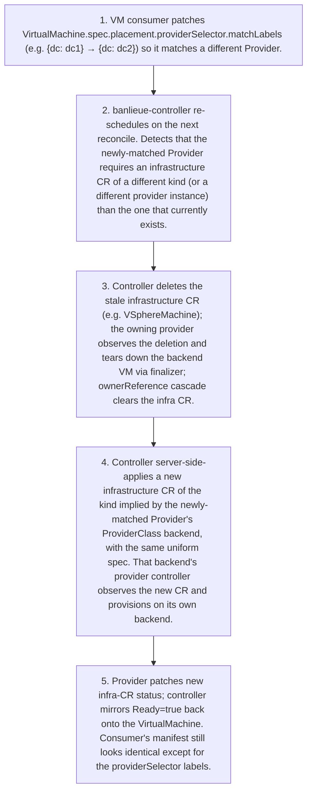

<sub>Source: flow `flow-swap-provider` in `architecture.json`.</sub>


## Delete a VirtualMachine (finalizer cleanup)

Deletion is gated by two finalizers (controller, provider) to guarantee that the backend VM is torn down BEFORE the CR is removed from etcd. No leaks.

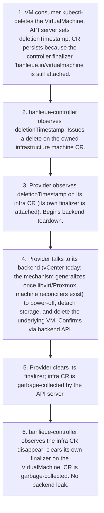

<sub>Source: flow `flow-delete-virtualmachine` in `architecture.json`.</sub>


## Provision a Kubernetes cluster via CAPI (banlieue as infra provider)

The platform operator provisions a k0s cluster by applying upstream CAPI objects plus banlieue's VSphereCluster (InfraCluster) and a VSphereMachineTemplate. banlieue does NOT own cluster lifecycle — CAPI + a control-plane provider (k0smotron) do. banlieue's job is to advertise failure domains (VSphereCluster) and realise each machine (VSphereMachine). 'replicas: N' spread across failure domains is how a tier (e.g. 6/6 'platinum') is expressed (ADR-0001).

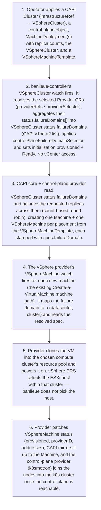

<sub>Source: flow `flow-provision-capi-cluster` in `architecture.json`.</sub>


## Deliver a CAPI Machine&#x27;s bootstrap data to its InfraMachine (ADR-0129 milestone 1)

ACCEPTED (ADR-0129); milestone 1 IMPLEMENTED (controller serving CloudHypervisorMachine, Cloud Hypervisor hold, admission policy; libvirt, vSphere and Proxmox are neither held nor served until milestone 2). A Machine that CAPI creates over a banlieue InfraMachineTemplate gets its bootstrap provider's rendered data in spec.userData before its guest is created. Shown for Cloud Hypervisor, the first backend to hold creation; libvirt, vSphere and Proxmox follow in milestone 2 (ADR-0129 Decision 8).

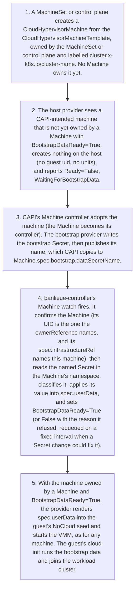

<sub>Source: flow `flow-capi-machine-bootstrap-data` in `architecture.json`.</sub>


## Build a VMImage from an OCI/Kairos image and import it per zone

A VMImage with a spec.sources[].kind==Url entry (an OCI-referenced Kairos image, e.g. from a nightly build pipeline) is turned into a typed build artifact — a raw cloud image for libvirt, a bootable ISO with a baked-in default cloud-config for vSphere — by banlieue-imagebuilder via kairos-operator, then imported into every zone of a matching vSphere Provider by banlieue-provider-vsphere as a fully installed, generalized, marked template. The two controllers never call each other; VMImage.status.buildArtifact is the entire handoff. See ADR-0010, ADR-0020, ADR-0021, and ADR-0022.

```mermaid
flowchart TD
    t1["1. Platform operator (or a nightly CI job authenticated as one) applies/updates a VMImage with a Url source pointing at the newly-built Kairos OCI image, optionally with spec.cloudConfigs[] (an ordered, layered list of secretRef/configMapRef sources, ADR-0037), spec.isoOverlay (secretRef + files[], ADR-0022), and spec.template (rootFolder / network[] / disk / force knobs) for the vSphere template."]
    t2["2. banlieue-imagebuilder's VMImage watch fires. It server-side-applies an OSArtifact CR requesting a cloud image (libvirt sources) or an ISO with artifacts.cloudConfigRef resolved from the merged spec.cloudConfigs[] (vsphere sources, ADR-0037), sets VMImage.status.buildArtifact.phase=Building, and — when spec.isoOverlay is set — adds spec.volumes[] (a Secret volume named by the declared key/path list) plus artifacts.overlayISOVolume pointing at it, the same auroraboot --overlay-iso mechanism the maintainer's proven manual ISO-build pipeline already relies on (ADR-0022). When spec.trustedBoot is set instead, it requests artifacts.uki.iso (not artifacts.iso) with keysVolume pointing at a Secret volume named by trustedBoot.secretRef — the six fixed files auroraboot build-uki requires (PK.auth, KEK.auth, db.auth, db.key, db.pem, tpm2-pcr-private.pem), generated out-of-band via auroraboot genkey (ADR-0051). Only the Secret's name (and, for isoOverlay, declared key names) is read, never its content."]
    t3["3. kairos-operator's OSArtifact watch fires. It pulls the OCI image and builds the artifact — a raw disk, or auroraboot build-iso with --cloud-config for an ISO — writing it to a PVC it creates, progressing status.phase through Building -> Exporting -> Ready."]
    t4["4. banlieue-imagebuilder's OSArtifact watch fires on the Ready transition. It patches VMImage.status.buildArtifact with kind (cloudImage | iso), phase=Ready, the artifacts PVC reference, the artifact file name, and the checksum."]
    t5["5. banlieue-provider-vsphere's VMImage watch fires. It finds a Url-kind vsphere source with buildArtifact.phase==Ready and kind==iso and begins a per-zone import for each of its Providers' status.failureDomains[]."]
    t6["6. For each zone, an image-import Job (banlieue binary's image-import subcommand, imagebuild namespace, artifacts PVC mounted read-only) verifies the ISO against buildArtifact.checksum, uploads it to the zone's datastore — reusing the datastore-cluster member already holding it, else the emptiest — ensures <spec.template.rootFolder>/<failure-domain-name> (every zone gets its own subfolder, since vSphere folders are scoped per-datacenter, not per-cluster, and zones commonly share a datacenter), and creates the VM: empty EFI VM (pvscsi disk from spec.template.disk, vmxnet3 NIC on the spec.template.network or zone port group), ISO attached as CD-ROM. It then powers the VM on and waits for the cloud-config's unattended Kairos install to run its after-install-chroot identity-wipe stage and power the VM off itself (install.poweroff, no reboot), bounded by spec.template.installTimeoutSeconds; on success it removes the CD-ROM device and MarkAsTemplate — the disk is never booted by the build, so each real clone's first boot generates its own machine-id/SSH host keys (ADR-0021)."]
    t7["7. banlieue-provider-vsphere patches VMImage.status.perProvider[].zones[] with per-zone readiness and resolvedRef (the template's [datastore] folder/name), using its own field manager — never touching status.buildArtifact."]
    t1 --> t2 --> t3 --> t4 --> t5 --> t6 --> t7
```

<sub>Source: flow `flow-build-vmimage-from-oci` in `architecture.json`.</sub>


## Import a built raw disk into libvirt storage pools

The libvirt half of ADR-0010's pipeline: once banlieue-imagebuilder has produced a raw disk, banlieue-provider-libvirt imports it into each storage pool the Provider advertises. Demonstrates the same build-then-import split as the vSphere path, on a backend that needs no proprietary SDK. See ADR-0011.

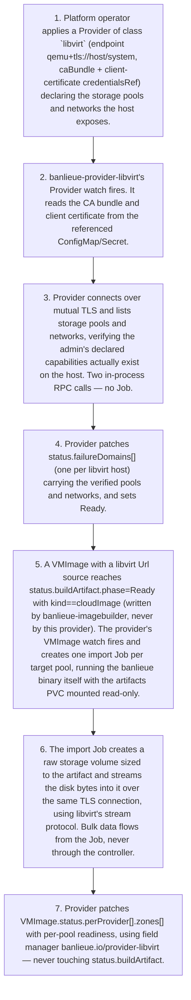

<sub>Source: flow `flow-import-vmimage-libvirt` in `architecture.json`.</sub>


## Register a backend and have its controller provisioned automatically

The flow that makes banlieue an operator in the strict sense: a platform owner declares a ProviderClass once (image, resources, namespace), then applies a Provider CR per backend instance. banlieue-operator turns each Provider into a dedicated Deployment + ServiceAccount + Role + RoleBinding, so one hung or slow backend cannot stall reconciliation for any other and each pod holds exactly one backend's credentials. Deleting the Provider garbage-collects the whole set via owner references. See ADR-0003 (per-instance topology) and ADR-0012.

```mermaid
flowchart TD
    t1["1. Platform operator installs the platform with `banlieue bootstrap operator` — namespace, CRDs built from the binary's own Rust types, controller and operator RBAC and Deployments, plus one ProviderClass per backend compiled into the binary (ADR-0013). `--dry-run` emits the same YAML for a GitOps repo instead of applying it."]
    t2["2. Platform operator applies a Provider CR naming its ProviderClass, the backend endpoint, and a credentials Secret in the same namespace."]
    t3["3. banlieue-operator's Provider watch fires. It resolves the referenced ProviderClass and server-side-applies a ServiceAccount, a Role scoped by resourceNames to just that Provider's credentials Secret, a RoleBinding, and a Deployment running `banlieue provider <backend>` — all carrying an ownerReference back to the Provider."]
    t4["4. The spawned provider pod starts, acquires its own leader-election Lease (banlieue-provider-<class>-<provider-name>), and begins a server-side filtered watch on labelSelector banlieue.io/provider=<name> so its informer cache holds only its own infra objects."]
    t5["5. The provider logs in to its backend with the one credential it can read, introspects the inventory, and publishes reachable failure domains to Provider.status.failureDomains — the input the main controller's scheduler matches VirtualMachines against."]
    t6["6. banlieue-operator's Deployment watch fires as replicas become ready and mirrors readiness into Provider.status.workload. It also reads the provider's leader-election Lease from step 4 and records status.workload.heartbeat (Alive, then Stale if the Lease stops renewing), which the scheduler uses to place nothing new on a provider that has stopped (ADR-0102). It deliberately does not write status.conditions: that list is owned by the provider's own field manager, and a plain list without x-kubernetes-list-type:map cannot be merged per-entry by two managers."]
    t1 --> t2 --> t3 --> t4 --> t5 --> t6
```

<sub>Source: flow `flow-provision-provider-workload` in `architecture.json`.</sub>


## Upgrade every backend of a class with one edit

The payoff of putting install metadata on a ProviderClass rather than on each Provider: bumping a fleet is a one-object edit, not one edit per backend. banlieue-operator watches ProviderClass and maps each edit back to every Provider referencing it, so the change lands at once instead of waiting on a periodic requeue. The same path makes un-pausing a class immediate. See ADR-0012.

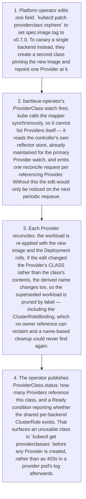

<sub>Source: flow `flow-upgrade-provider-fleet` in `architecture.json`.</sub>


## Claim a warm pool member for one subject

How a consumer gets a sandbox in seconds instead of waiting out provisioning, and how the cluster records who got it. The interesting property is that nothing in this path locks anything: the API server is already the serialisation point, so a resourceVersion precondition on one merge patch is the whole concurrency story (ADR-0046, ADR-0047).

```mermaid
flowchart TD
    t1["1. Consumer authenticates to the issuer (kubectl oidc-login / kubelogin, PKCE browser flow) and receives a signed ID token, cached locally and replayed as a bearer token."]
    t2["2. API server verifies the token against the issuer's JWKS and derives request.userInfo.username by prepending --oidc-username-prefix. This is the only identity assertion the rest of the path can trust."]
    t3["3. Consumer creates a VirtualMachineClaim naming a pool, a mandatory ttlSeconds, and a subject. Admission compares the claim issuer's prefix (its issuerPrefixes entry, else usernamePrefix) + spec.subject.id against the authenticated username, which with a distinct prefix per issuer also binds the claim to the issuer that authenticated its author (ADR-0047 Decision 9, amended 2026-10-13), and checks spec.subject.issuer against the operator allowlist. CREATE only: on UPDATE the requester is normally the controller adding its own finalizer, and applying the identity check there denies it, leaving claims that are created and then never reconciled."]
    t4["4. IMPLEMENTED (ADR-0135): with more than one Ready candidate, the claim reconciler reads the candidates' Providers to rank members on a cordoned or Stale host last, and for Spread counts the subject's Claimed members per (provider, failure domain). Read-only."]
    t5["5. Claim reconciler picks one Ready, unclaimed member (current image revision first, then host health and the claim's selection strategy per ADR-0135, then longest-Ready, then name) and binds it with a resourceVersion-preconditioned merge patch: claim label, subject annotations, and ownerReferences re-parented from pool to claim. A second claim racing for the same member gets 409 and picks again. Status then publishes virtualMachineRef, boundAt and expiresAt = boundAt + ttlSeconds, counted from the bind instant so a claim that waited for capacity still gets its full TTL."]
    t6["6. The pool sees a member it may no longer count as warm and creates a replacement, so the next consumer still finds one Ready. The pool never learns that claims exist."]
    t7["7. On deletion or at expiresAt the claim deletes its member and holds its own finalizer until that member is gone from the API server, while the member's provider finalizer holds IT until the backend VM is destroyed. So a deleted claim means a destroyed sandbox, transitively. A vanished member fails the claim terminally rather than rebinding it: a consumer holding a claim believes it is talking to one specific VM."]
    t1 --> t2 --> t3 --> t4 --> t5 --> t6 --> t7
```

<sub>Source: flow `flow-claim-pool-member` in `architecture.json`.</sub>


## Deliver a subject&#x27;s credential to its sandbox (banlieue side implemented; agent and broker are not banlieue code)

The unanswered half of the claim model: a claim deliberately carries no credential, so how does the subject's token reach the guest and what convinces the guest it is genuine? ADR-0049 is Accepted (2026-09-27) and banlieue's whole side of the contract exists: subject.issuer, subject.id, the mirrored EK certificate (ADR-0045, landed 2026-09-23), and the per-backend trust anchor Provider.spec.attestation.ekTrustBundle (Decision 10, admin-supplied, never discovered -- an anchor fished off the hypervisor would let the host vouch for its own guests). The in-guest agent and the broker are by design not banlieue code (mediatore, ADR-0097); mediatore attests with SPIRE's TPM node attestation, which superseded ADR-0049's quote-over-nonce handshake and retired status.nonce (amended 2026-11-05).

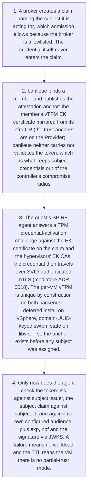

<sub>Source: flow `flow-attest-and-deliver-credential` in `architecture.json`.</sub>


## Publish a sandbox&#x27;s vTPM endorsement key certificate

ADR-0045. A quote is only as good as the certificate it is checked against, so every tpmEnabled member publishes its vTPM EK certificate before it is bindable. The two backends are not symmetric and cannot be: vCenter issues the certificate and exposes it host-side pre-boot, while on libvirt swtpm_localca issues it into the vTPM's NVRAM and persists it nowhere -- no libvirt RPC and no host file holds a copy -- so the only readable location is inside the guest. banlieue therefore reads it the way it reads ADR-0043's phase marker: read-only, over guest-file-open/guest-file-read, never guest-exec, which would be a host-to-guest RCE primitive acquired to fetch a public key.

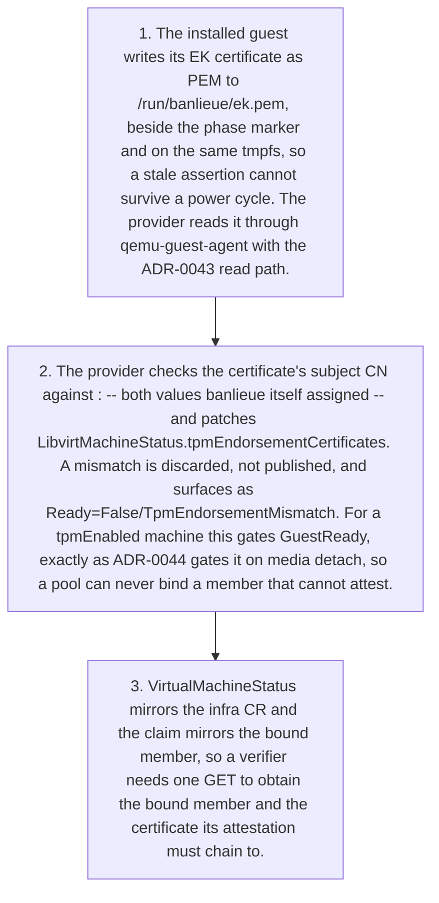

<sub>Source: flow `flow-publish-vtpm-ek-certificate` in `architecture.json`.</sub>


## Create a VirtualMachine on a Cloud Hypervisor host

Same front half as every backend; the back half runs on the KVM host. Verified end to end against a k0s cluster and a bare-metal host (2026-09-26).

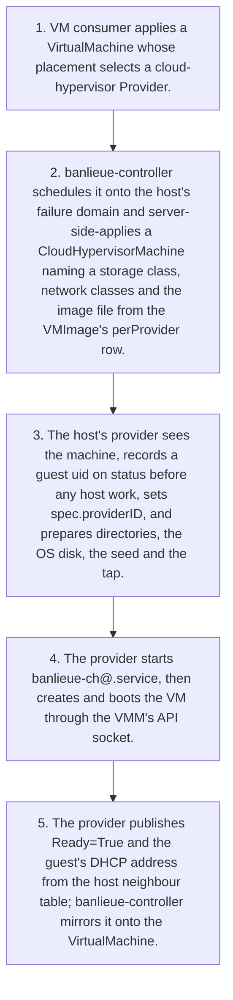

<sub>Source: flow `flow-create-virtualmachine-cloud-hypervisor` in `architecture.json`.</sub>


## Deliver a built image to a Cloud Hypervisor host through a registry

ADR-0064's registry path: a host-resident provider cannot mount the artifacts PVC, so the build is pushed to an OCI registry and each host pulls it by digest into its own image cache.

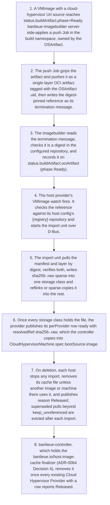

<sub>Source: flow `flow-import-vmimage-cloud-hypervisor` in `architecture.json`.</sub>


## Move a running VM between Cloud Hypervisor hosts in one zone

ACCEPTED (ADR-0127), not yet implemented: a vMotion-shaped move on local storage. faubourg (or a person) asks; banlieue's controller orchestrates through the two CloudHypervisorMachines; the two host providers copy the disk and relay the VMM state over one per-move TLS connection. Stage 1 moves VMs without a vTPM and pauses for the disk delta plus the whole guest memory; a vTPM guest moves from Stage 2, once Cloud Hypervisor carries vTPM state in its own migration stream (swtpm serves one control client, the VMM).

```mermaid
flowchart TD
    t1["1. faubourg drains a Host: it cordons the Provider and creates a VirtualMachineMove with no target for each VM scheduled on it."]
    t2["2. The controller admits the move, picks the destination in the zone, creates the destination machine (spec.moveIn, spec.identity) and sets spec.moveOut on the source machine."]
    t3["3. Each provider generates a per-move key and publishes its certificate (the destination also its endpoint, an empty VMM waiting); the controller copies each to the other machine's spec."]
    t4["4. The source reflink-clones the disk and streams the clone while the guest runs, then reports Precopied."]
    t5["5. On cutover the source provider pauses the guest; the VMM sends its state to the provider's UNIX socket and exits; the destination VMM receives it and stays paused."]
    t6["6. The disk delta (extents no longer shared with the clone, plus discarded ranges) and the VMM stream cross to the destination, which reports Received."]
    t7["7. Only after the source reports Sent and its VMM has exited does the controller write commit on the destination machine."]
    t8["8. The destination provider resumes the guest (same MAC, same addresses) and reports Running."]
    t9["9. The controller switches the VM's status.scheduled to the destination, deletes the source machine (its finalizer removes the old disk and clone) and marks the move Succeeded with its downtime."]
    t1 --> t2 --> t3 --> t4 --> t5 --> t6 --> t7 --> t8 --> t9
```

<sub>Source: flow `flow-move-virtualmachine-cloud-hypervisor` in `architecture.json`.</sub>


## Publish measured capacity and fit a new placement against it

IMPLEMENTED (ADR-0128): each provider measures its backend at the Provider reconcile cadence, publishes typed capacity on its failure domains, and the scheduler fits new placements against it alongside ADR-0107's reservation check. Shown for libvirt; vSphere, Proxmox and Cloud Hypervisor follow the same three steps over their own relationships.

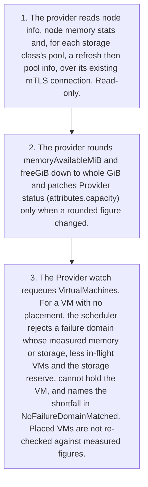

<sub>Source: flow `flow-publish-and-fit-measured-capacity` in `architecture.json`.</sub>


## Create a VirtualMachine served by a shared provider (ADR-0133)

A tenant namespace with no Provider is served by the platform's provider, which runs in the provider namespace with the credentials and watches tenant namespaces by selector. The pool, VMs, claims and machine all stay in the tenant namespace; only the providerRef crosses.

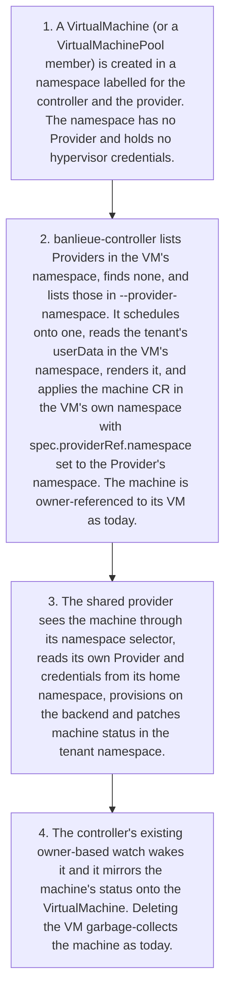

<sub>Source: flow `flow-create-virtualmachine-shared-provider` in `architecture.json`.</sub>


## Give a Cloud Hypervisor guest a host PCI device

ADR-0136, PROPOSED. A VMClass (or a CloudHypervisorMachineTemplate) names a device class; the host decides which device, root grants the guest's uid exactly that device's IOMMU group, and the sandboxed VMM attaches it.

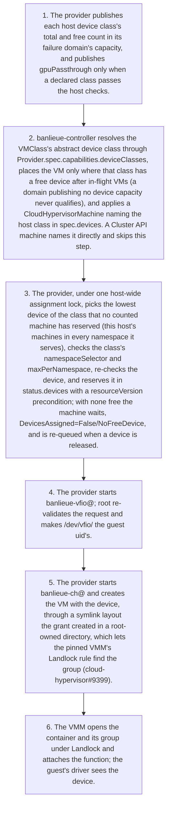

<sub>Source: flow `flow-assign-pci-device-cloud-hypervisor` in `architecture.json`.</sub>


## Create a VirtualMachine on a Firecracker host, from request to GuestReady and attested

DESIGNED, NOT IMPLEMENTED (ADR-0137, ADR-0140, ADR-0142, ADR-0143). The back half runs on a KVM host with no vTPM: identity comes from a certificate the host signs for the guest's own key, not from an endorsement key.

```mermaid
flowchart TD
    t1["1. VM consumer applies a VirtualMachine whose placement selects a firecracker Provider; a request for a vTPM or hotplug is refused at admission."]
    t2["2. banlieue-controller schedules it onto the host's failure domain, against the capacity of banlieue-firecracker.slice, and applies a FirecrackerMachine."]
    t3["3. The host's provider sees the machine, records a guest uid on status before any host work and publishes status.attestationSubject, the machine's metadata.uid, so mediatore can compute the node entry's parent before the guest boots."]
    t4["4. The provider prepares the tap and the uid-owned boot configuration, composes the kernel command line (platform arguments, then the image's, ip= for the static address), starts banlieue-firecracker@<uid>.service and opens its per-guest vsock listeners."]
    t5["5. The VMM boots the cached kernel and initramfs over the shared read-only root, with a RAM overlay for writes."]
    t6["6. The guest reports readiness on port 1024; the provider publishes GuestReady and the static address, and banlieue-controller mirrors it onto the VirtualMachine."]
    t7["7. The guest makes its own key and sends a CSR on port 1025; the signer takes only the public key and answers with one short-lived certificate whose subject is attestationSubject."]
    t8["8. The in-guest SPIRE agent attests with x509pop against the SPIRE server, which trusts the host CA the administrator asserted in Provider.spec.attestation.hostCa; the agent ID is x509pop/<issuer CN>/<attestationSubject>."]
    t1 --> t2 --> t3 --> t4 --> t5 --> t6 --> t7 --> t8
```

<sub>Source: flow `flow-create-virtualmachine-firecracker` in `architecture.json`.</sub>


## Pull a microvm image into a Firecracker host&#x27;s cache

DESIGNED, NOT IMPLEMENTED (ADR-0142). The image is the consumer's own build, pushed to a registry by the consumer's pipeline; each host pulls it by digest and verifies it before it becomes visible.

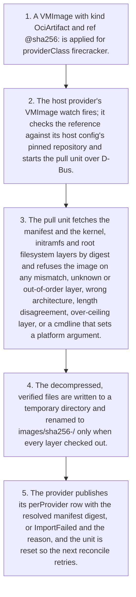

<sub>Source: flow `flow-import-vmimage-firecracker` in `architecture.json`.</sub>


## A Cloud Hypervisor guest attests with a certificate its host signs (ADR-0146, proposed)

PROPOSED (ADR-0146), not yet implemented. The x509pop alternative to the vTPM path for a guest on a shared host, extending ADR-0143's Firecracker design to Cloud Hypervisor. The signing CA is banlieue's own, owned by the provider alone, and asserted by the administrator on the Provider. The certificate subject is the CloudHypervisorMachine's metadata.uid, published as status.attestationSubject and mirrored machine to VirtualMachine to claim so mediatore can compute the node entry's parent. The guest-side helper is mediatore's (ADR-0049), not decided here.

```mermaid
flowchart TD
    t1["1. The installer made the CA; the administrator asserts ca.crt as Provider.spec.attestation.hostCa and adds it to the SPIRE server's x509pop bundle. Until then the opted-in host is Ready=False/HostCaMissing. Alternatively (Decision 7) the installer wrote a CSR, the administrator had it signed on the node-attestation PKI mount, and the signed ca.crt was imported, or (Decision 8) the installer had OpenBao sign it in one run, logging in as the host's own ServiceAccount; the SPIRE bundle then holds that mount's root, and the signer's reply carries the chain."]
    t2["2. The guest helper makes a key and sends a CSR over vsock port 1025; the signer returns a certificate whose CN is the machine's metadata.uid."]
    t3["3. The provider publishes CloudHypervisorMachineStatus.attestationSubject (the machine's metadata.uid). A Recreate makes a new machine and so a new subject."]
    t4["4. The controller mirrors attestationSubject onto VirtualMachineStatus and then onto the claim (ADR-0143 Decision 3), replacing it on every mirror so a withdrawn subject does not linger."]
    t5["5. The guest's SPIRE agent attests with x509pop against the bundle of per-host CAs; mediatore reads the subject from the claim to place the node entry."]
    t1 --> t2 --> t3 --> t4 --> t5
```

<sub>Source: flow `flow-attest-with-host-signed-certificate-cloud-hypervisor` in `architecture.json`.</sub>


## An Azure allocation failure re-places the machine in another zone (ADR-0173)

IMPLEMENTED (ADR-0173, ADR-0161 Decision 2). The provider reports a zone-specific create failure; the controller, the only placer, re-places a machine that never ran, excluding the failed zone for a bounded, exponential time. Nothing new crosses the CRD-only bus.

```mermaid
flowchart TD
    t1["1. The VM create is refused or its operation fails with ZonalAllocationFailed, AllocationFailed, SkuNotAvailable or an Overconstrained code."]
    t2["2. The provider sets AzureVirtualMachine VMCreated=False reason ZoneUnavailable (lastTransitionTime = the failure) and increments status.createFailures; it never edits spec.zone."]
    t3["3. The controller reads the failure for the recorded placement, records it on VirtualMachine.status.placementFailures and schedules again with that failure domain excluded."]
    t4["4. With another placement, the controller writes status.scheduled and deletes the AzureVirtualMachine; the provider's finalizer removes the NIC and leftovers by owner tag, and the next pass applies a fresh machine in the new zone. With none, the machine stays and the provider retries in place after its back-off."]
    t1 --> t2 --> t3 --> t4
```

<sub>Source: flow `flow-replace-azure-virtual-machine-after-allocation-failure` in `architecture.json`.</sub>

