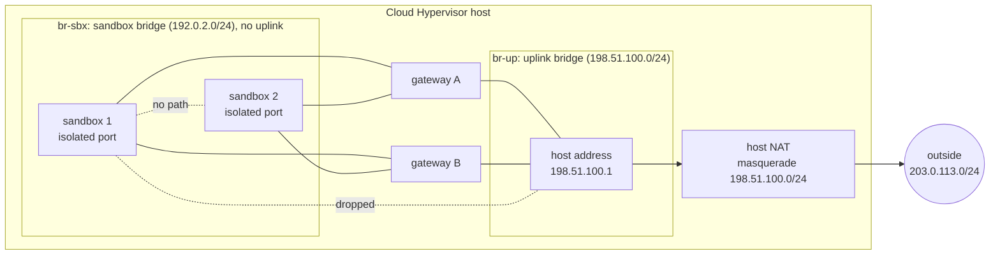

<!--
Copyright (c) 2026 Erick Bourgeois, banlieue
SPDX-License-Identifier: Apache-2.0
-->
# Cloud Hypervisor host: the sandbox segment

A Cloud Hypervisor host that runs agent sandboxes (guests that execute code
nobody reviewed) must not let one sandbox reach another, must not let a
sandbox reach the host, and must give sandboxes exactly one way out: two
egress gateway VMs. This page is the operator recipe for that: two internal
bridges, host firewall rules, and the host config that tells the provider to
isolate each sandbox's port. The decision and its reasons are
[ADR-0144](https://github.com/firestoned/banlieue/blob/main/docs/adr/0144-sandbox-segment-and-egress-gateways-on-a-cloud-hypervisor-host.md);
the binary creates none of this (ADR-0067 Decision 7: it never makes a bridge
and installs no package), so every step here is yours.

!!! info "Status"
    ADR-0144 is **Accepted**. The `isolate_ports` class attribute, the
    installer flag, the `preflight` kernel check and the provider's port
    isolation are implemented. **Not implemented yet:** a `preflight` check of
    the host firewall rules (ADR-0144 Decision 6 plans it), gateway-side
    neighbour pinning, and failover of the gateway address. Until the firewall
    check lands, you verify the rules yourself with the commands in
    [Step 4](#step-4-verify-isolation).

Placeholders throughout: bridges `br-sbx` (sandbox) and `br-up` (uplink),
sandbox range `192.0.2.0/24`, uplink range `198.51.100.0/24`, outside world
`203.0.113.0/24`. Replace them with your own. These are documentation ranges
(RFC 5737) for the examples only: see
[Addressing](#addressing-sandbox-addresses-are-unique-across-the-fleet) for how
a real host's range is chosen.

## What the segment is



| Piece | What it is |
| --- | --- |
| Sandbox bridge `br-sbx` | An internal bridge with no physical port and no uplink. Sandboxes have one NIC on it, a static address, and a default route to the gateway address, never to the host. |
| Port isolation | The provider sets `isolated on` on each sandbox's tap, so a sandbox reaches only non-isolated ports: the gateways. |
| Uplink bridge `br-up` | An internal bridge carrying the gateways' second NIC and the host's address `198.51.100.1`, which is the gateways' next hop. |
| Two gateway VMs | Ordinary VMs with two NICs (`br-sbx` and `br-up`), placed on this host. Their ports are not isolated. They enforce what a sandbox may reach (mediatore ADR-0028, ADR-0030). |
| Host NAT | The host masquerades the uplink range out of every interface except `br-up`. Beyond the host the source is the host's existing address; no routable address is added. |
| Host rules | INPUT and FORWARD drops so a sandbox cannot use the host as a service or a router. |

The sandbox range is **never** masqueraded and **never** forwarded. Only the
gateways' uplink leg is.

## Addressing: sandbox addresses are unique across the fleet

Sandbox addresses are private and **unique across the fleet** (ADR-0144
Decision 2): no two sandboxes anywhere hold the same address, and no host
reuses another host's sandbox range. So a host's sandbox range is **not**
chosen per host and has no default. It is carved from one fleet-wide private
supernet, recorded in the fleet's allocation, and only then written into the
host's bridge configuration and the pool that hands out addresses. The
gateways' own addresses on the sandbox segment come from the same host range.

The uplink segment and the host's own bridge addresses are different: they
may repeat from host to host, because the host masquerades the uplink and
nothing routes either. Only sandbox addresses must be unique.

In this page `192.0.2.0/24` stands for one host's carve-out and
`198.51.100.0/24` for an uplink range that several hosts may share. Both are
documentation ranges; take a real host's sandbox range from the fleet
allocation, never from this page.

## Step 1: the two bridges

Neither bridge has a physical port. A bridge with no port has no carrier and
goes down, taking its address with it, so each gets a **dummy port** as an
anchor: it keeps the bridge up while no guest is attached.

The sandbox bridge gets **no host address** (preferred; see
[open questions](#open-questions)). The uplink bridge gets the host's address
in the uplink range, because the gateways use it as their next hop.

=== "NetworkManager (RHEL 8 and similar)"

    ```sh
    # sandbox bridge: no address of any kind, anchored by a dummy port
    sudo nmcli con add type bridge ifname br-sbx con-name br-sbx \
      bridge.stp no ipv4.method disabled ipv6.method disabled \
      connection.autoconnect yes
    sudo nmcli con add type dummy ifname dummy-sbx con-name dummy-sbx \
      master br-sbx slave-type bridge connection.autoconnect yes

    # uplink bridge: the host's address in the uplink range, IPv6 off
    sudo nmcli con add type bridge ifname br-up con-name br-up \
      bridge.stp no ipv4.method manual ipv4.addresses 198.51.100.1/24 \
      ipv6.method disabled connection.autoconnect yes
    sudo nmcli con add type dummy ifname dummy-up con-name dummy-up \
      master br-up slave-type bridge connection.autoconnect yes

    sudo nmcli con up br-sbx && sudo nmcli con up dummy-sbx
    sudo nmcli con up br-up  && sudo nmcli con up dummy-up
    ```

    **Verify the profiles survive a reboot.** A profile that lives only in
    `/run` is gone at the next boot, and nothing says so until then. Where
    NetworkManager stored each profile depends on its plugin: the `ifcfg-rh`
    plugin (RHEL 8's default) writes
    `/etc/sysconfig/network-scripts/ifcfg-<name>`, the keyfile plugin writes
    `/etc/NetworkManager/system-connections/<name>.nmconnection`. Either is
    persistent; `/run/NetworkManager/...` is not:

    ```sh
    nmcli -f NAME,FILENAME,AUTOCONNECT con show | rg 'br-|dummy-'
    # every FILENAME must be under /etc/, AUTOCONNECT yes. A path under
    # /run/ means the profile was created temporarily: recreate it.

    # prove it without a reboot: reload from disk, restart, re-check
    sudo nmcli con reload
    sudo systemctl restart NetworkManager
    ip -br link show type bridge          # br-sbx and br-up, state UP
    ip -d link show dummy-sbx | rg 'master br-sbx'
    ```

    Do the restart from a console, not over the only SSH session that depends
    on the host's other connections; and do one real reboot before the host
    serves sandboxes.

=== "ip (other hosts, not persistent)"

    ```sh
    for b in br-sbx br-up; do
      sudo ip link add "$b" type bridge stp_state 0
      sudo ip link add "dummy-${b#br-}" type dummy
      sudo ip link set "dummy-${b#br-}" master "$b" up
      sudo sysctl -w "net.ipv6.conf.$b.disable_ipv6=1"
      sudo ip link set "$b" up
    done
    sudo ip addr add 198.51.100.1/24 dev br-up   # the host's uplink-side address
    ```

    These do not survive a reboot. Put the same into your distribution's
    network configuration (`systemd-networkd` `.netdev`/`.network` files,
    `/etc/network/interfaces`, ...) and check it as above.

The provider joins each guest's tap to the bridge its network class names; it
never creates the bridge (ADR-0063).

## Step 2: the host rules

The host has `ip_forward = 1` and a FORWARD policy of ACCEPT, set by another
tenant (a container runtime and kubelet networking), and may have
`br_netfilter` loaded with `bridge-nf-call-iptables = 1`, so bridged frames
also traverse the iptables FORWARD chain. None of that is yours to change. The
recipe therefore:

- owns three chains (`BANLIEUE_SBX_INPUT`, `BANLIEUE_SBX_FORWARD` in `filter`,
  `BANLIEUE_SBX_NAT` in `nat`) and one jump to each at position 1;
- never flushes, replaces or reorders any other rule;
- loads its chains with `iptables-restore --noflush`, one atomic commit, so a
  second run leaves no gap and no duplicate;
- on `reload` puts its jumps back at position 1 if another tenant inserted
  its own above them;
- on stop removes only its own chains.

It uses `iptables` because `nft` is not installed on the measured host. On
RHEL 8 that is the nf_tables backend (`iptables-nft`), which is fine.

| Rule | Effect |
| --- | --- |
| INPUT from `br-sbx`: drop | A sandbox reaches no service of the host, on any of the host's addresses. |
| INPUT from `br-up`: accept established/related, drop the rest | The gateways reach nothing on the host. NAT needs no INPUT rule: forwarded traffic and its replies go through FORWARD. |
| FORWARD `-i br-sbx ! -o br-sbx`: drop | A sandbox cannot use the host as a router. |
| FORWARD `! -i br-sbx -o br-sbx`: drop | Nothing outside the segment, the uplink bridge included, reaches a sandbox through the host. |
| FORWARD to `br-up`: replies accepted, new connections from anywhere but `br-up` dropped | Nothing new enters the uplink side. |
| FORWARD `-i br-up ! -o br-up`: accept | The gateways go out. |
| nat: `-s <uplink range> ! -o br-up` masquerade | Only the uplink range is translated, out of every interface except `br-up`. |
| `net.ipv6.conf.<bridge>.disable_ipv6=1` | The segment is IPv4 only. |

The `! -o` and `! -i` qualifiers are deliberate: with `br_netfilter`, frames
bridged inside one bridge also traverse FORWARD with the same interface as
both input and output, and must be left to the bridge and to port isolation.

The ACCEPT for `-i br-up ! -o br-up` ends FORWARD traversal for that packet,
so it also bypasses any later DROP rule of another tenant for gateway
traffic. That is intended (the gateways must get out) and is the one place
the recipe overrides a later rule; check it against your host's policy.

Three files, all `root:root`.

`/etc/banlieue/sandbox-segment.env` (`0644`):

```sh
# /etc/banlieue/sandbox-segment.env
# Read by banlieue-sandbox-segment (and its unit). Placeholders: replace.
SBX_BRIDGE=br-sbx
UP_BRIDGE=br-up
# The uplink bridge's range: the only range that is masqueraded.
UP_RANGE=198.51.100.0/24
```

`/usr/local/sbin/banlieue-sandbox-segment` (`0755`):

```bash
#!/bin/bash
# /usr/local/sbin/banlieue-sandbox-segment   (root:root, 0755)
#
# Host rules for a Cloud Hypervisor host that serves sandboxes (ADR-0144
# Decisions 5 and 6). Usage: banlieue-sandbox-segment apply | remove
#
# It owns three chains and nothing else:
#   filter  BANLIEUE_SBX_INPUT, BANLIEUE_SBX_FORWARD
#   nat     BANLIEUE_SBX_NAT
# and one jump to each, kept at position 1 of INPUT, FORWARD and POSTROUTING.
# It never flushes, replaces or reorders any other rule, so another tenant of
# the host (container runtime, kubelet networking) is untouched. `apply` is
# idempotent: run it again after anything reloads the firewall.
set -euo pipefail

: "${SBX_BRIDGE:?set in /etc/banlieue/sandbox-segment.env}"
: "${UP_BRIDGE:?set in /etc/banlieue/sandbox-segment.env}"
: "${UP_RANGE:?set in /etc/banlieue/sandbox-segment.env}"

IPT="iptables -w"

# table hook chain
JUMPS=(
  "filter INPUT BANLIEUE_SBX_INPUT"
  "filter FORWARD BANLIEUE_SBX_FORWARD"
  "nat POSTROUTING BANLIEUE_SBX_NAT"
)

rules() {
  cat <<RULES
*filter
:BANLIEUE_SBX_INPUT - [0:0]
:BANLIEUE_SBX_FORWARD - [0:0]
# INPUT: nothing on the sandbox bridge reaches the host. The uplink bridge
# reaches it only for replies to what the host itself started.
-A BANLIEUE_SBX_INPUT -i ${SBX_BRIDGE} -j DROP
-A BANLIEUE_SBX_INPUT -i ${UP_BRIDGE} -m conntrack --ctstate ESTABLISHED,RELATED -j ACCEPT
-A BANLIEUE_SBX_INPUT -i ${UP_BRIDGE} -j DROP
# FORWARD: the sandbox bridge reaches nothing outside itself, and nothing
# outside it (the uplink bridge included) reaches the sandbox bridge. The
# "! -o" and "! -i" matter: with br_netfilter, frames bridged inside one
# bridge also traverse this chain and must be left to the bridge (and to
# port isolation).
-A BANLIEUE_SBX_FORWARD -i ${SBX_BRIDGE} ! -o ${SBX_BRIDGE} -j DROP
-A BANLIEUE_SBX_FORWARD ! -i ${SBX_BRIDGE} -o ${SBX_BRIDGE} -j DROP
# The uplink bridge: replies in, new connections out, nothing new in.
-A BANLIEUE_SBX_FORWARD -o ${UP_BRIDGE} -m conntrack --ctstate ESTABLISHED,RELATED -j ACCEPT
-A BANLIEUE_SBX_FORWARD ! -i ${UP_BRIDGE} -o ${UP_BRIDGE} -j DROP
-A BANLIEUE_SBX_FORWARD -i ${UP_BRIDGE} ! -o ${UP_BRIDGE} -j ACCEPT
COMMIT
*nat
:BANLIEUE_SBX_NAT - [0:0]
-A BANLIEUE_SBX_NAT -s ${UP_RANGE} ! -o ${UP_BRIDGE} -j MASQUERADE
COMMIT
RULES
}

require_bridge() {
  ip link show dev "$1" >/dev/null 2>&1 || {
    echo "banlieue-sandbox-segment: bridge $1 does not exist" >&2
    exit 1
  }
}

# Keep our jump at position 1 without a window in which it is absent: insert
# a fresh one first, then delete any later duplicate.
pin_jump() {
  local table=$1 hook=$2 chain=$3 first
  first=$($IPT -t "$table" -S "$hook" | sed -n '2p')
  if [ "$first" = "-A $hook -j $chain" ]; then
    return 0
  fi
  $IPT -t "$table" -I "$hook" 1 -j "$chain"
  local n
  for n in $($IPT -t "$table" -L "$hook" -n --line-numbers \
      | awk -v c="$chain" 'NR > 2 && $2 == c && $1 > 1 { print $1 }' | sort -rn); do
    $IPT -t "$table" -D "$hook" "$n"
  done
}

apply() {
  require_bridge "$SBX_BRIDGE"
  require_bridge "$UP_BRIDGE"
  # IPv6 off on both bridges (the segment is IPv4 only).
  sysctl -qw "net.ipv6.conf.${SBX_BRIDGE}.disable_ipv6=1"
  sysctl -qw "net.ipv6.conf.${UP_BRIDGE}.disable_ipv6=1"
  # --noflush keeps every other rule; a chain named in the file is emptied and
  # refilled in one atomic commit, so a re-apply never leaves a gap.
  rules | iptables-restore -w --noflush
  local j
  for j in "${JUMPS[@]}"; do
    # shellcheck disable=SC2086
    pin_jump $j
  done
}

remove() {
  local j table hook chain
  for j in "${JUMPS[@]}"; do
    read -r table hook chain <<<"$j"
    while $IPT -t "$table" -D "$hook" -j "$chain" 2>/dev/null; do :; done
    $IPT -t "$table" -F "$chain" 2>/dev/null || true
    $IPT -t "$table" -X "$chain" 2>/dev/null || true
  done
}

case "${1:-}" in
  apply) apply ;;
  remove) remove ;;
  *) echo "usage: $0 apply|remove" >&2; exit 2 ;;
esac
```

`/etc/systemd/system/banlieue-sandbox-segment.service` (`0644`):

```ini
# /etc/systemd/system/banlieue-sandbox-segment.service
[Unit]
Description=banlieue sandbox segment host rules (ADR-0144)
Documentation=https://github.com/firestoned/banlieue/blob/main/docs/adr/0144-sandbox-segment-and-egress-gateways-on-a-cloud-hypervisor-host.md
# After the network is up, so the bridges exist. If another tenant manages
# the firewall (container runtime, kubelet, firewalld), add its units here:
#   After=docker.service containerd.service firewalld.service
Wants=network-online.target
After=network-online.target
# The provider must not start a sandbox before the rules are in place.
Before=banlieue-provider-cloud-hypervisor.service
ConditionPathExists=/etc/banlieue/sandbox-segment.env

[Service]
Type=oneshot
RemainAfterExit=yes
EnvironmentFile=/etc/banlieue/sandbox-segment.env
ExecStart=/usr/local/sbin/banlieue-sandbox-segment apply
# `systemctl reload` re-applies and moves the jumps back to position 1 after
# another tenant inserted its own above them.
ExecReload=/usr/local/sbin/banlieue-sandbox-segment apply
# Removes only the three chains and their jumps.
ExecStop=/usr/local/sbin/banlieue-sandbox-segment remove

[Install]
WantedBy=multi-user.target
```

Enable and check:

```sh
sudo systemctl daemon-reload
sudo systemctl enable --now banlieue-sandbox-segment.service
sudo iptables -S BANLIEUE_SBX_FORWARD
sudo iptables -S FORWARD | sed -n '2p'    # our jump is first
```

The unit runs after `network-online.target`, before the provider, and stays
active (`RemainAfterExit`) so `systemctl stop` removes the rules and
`systemctl reload` re-applies them. **Rule persistence is only as good as the
ordering against the other tenant** (see [open questions](#open-questions)):
anything that rewrites the firewall (a `firewalld` reload, a container
runtime restart that inserts jumps at the top of FORWARD) needs a
`systemctl reload banlieue-sandbox-segment` afterwards; add the tenant's
units to `After=` and `PartOf=` in a drop-in so that happens by itself.

## Step 3: declare the classes in the host config

`/etc/banlieue/cloud-hypervisor.toml` names the bridges; machines name only
the class (ADR-0062 Decision 4). Isolation is **per class**, and an isolated
port cannot be reached by other isolated ports. The gateways' sandbox-side NIC
must therefore be on a second class that names the **same bridge without
isolation** (ADR-0144 Decision 3). Three classes:

```toml
[network_classes]
sandbox-gw = "br-sbx"
uplink = "br-up"

[network_classes.sandbox]
bridge = "br-sbx"
isolate_ports = true
```

| Class | Bridge | Isolated | Used by |
| --- | --- | --- | --- |
| `sandbox` | `br-sbx` | yes | every sandbox's one NIC |
| `sandbox-gw` | `br-sbx` | no | each gateway's sandbox-side NIC |
| `uplink` | `br-up` | no | each gateway's other NIC |

A class written as a bare string (`uplink = "br-up"`) does not isolate. Nothing
infers isolation from a class name. The inline form
`sandbox = { bridge = "br-sbx", isolate_ports = true }` parses identically;
the installer writes the sub-table form above. In the file, the plain
`name = "bridge"` keys sit under `[network_classes]`, before any
`[network_classes.<name>]` sub-table, as TOML requires.

The gateways are machines with two NICs (`spec.nics` is a list; one tap per
NIC), placed on this host with `providerSelector` on a label unique to it: the
sandbox-side NIC on `sandbox-gw`, the other on `uplink`.

### Declaring it with the installer

```sh
sudo banlieue host cloud-hypervisor install \
  --network-class sandbox=br-sbx --network-class sandbox-gw=br-sbx \
  --network-class uplink=br-up \
  --isolate-ports sandbox
```

`--isolate-ports NAME` marks a declared class isolated. It repeats, and has the
environment variable `BANLIEUE_HOST_ISOLATE_PORTS` (comma-separated). It is
validated before anything is written:

- `NAME` must be a class declared with `--network-class` in the same run (or
  recorded in the kept config);
- `NAME` must be a valid class name (lowercase letters, digits and `-`);
- the same class may not be given twice.

An isolated class is rendered as the `[network_classes.sandbox]` sub-table
above; every other class stays a plain string. On a host `install` has already
prepared, the config is kept: a re-run **without** the flag keeps the recorded
isolation, so a routine re-install never silently turns it off. A flag that
**contradicts** the kept config (a different set of isolated classes) is
refused, naming the flag, unless you pass `--force`, which regenerates the
file.

`banlieue host cloud-hypervisor preflight` (which `install` runs first)
refuses an isolated class when the kernel has no
`/sys/class/net/<port>/brport/isolated`, and when the class's bridge has no
member port to probe: attach a port first. The dummy anchor ports from
[Step 1](#step-1-the-two-bridges) satisfy that. Preflight does **not** yet
check the host firewall rules; that check is planned (ADR-0144 Decision 6), so
verify them as in [Step 4](#step-4-verify-isolation).

At run time the provider sets `isolated on` on the tap of every guest whose
class isolates, over netlink. It fails closed: if it cannot isolate a tap, setting up that
guest's taps returns an error that names the tap and the class, rather than
leaving the port open. It re-applies
on every reconcile pass, so a tap that lost its flag gets it back.

On a host `install` has already prepared the config is kept, so edit the file
and restart the provider (`systemctl restart
banlieue-provider-cloud-hypervisor`); guests keep running (`KillMode=process`).
The provider ensures a guest's taps on every reconcile pass for any machine
that is not powered off, before it looks at whether the VMM unit is running
(`ensure_taps` in `machine.rs`, which calls `ensure_tap_isolated`). A sandbox
that is already running is therefore isolated within one pass after the
provider restarts, and nothing needs recreating. Confirm with the
`bridge -d link show` command in Step 4: every sandbox tap should read
`isolated on`. A tap that still reads `isolated off` a minute after the restart
means the provider logged an error for that guest; read the journal before
recreating anything.

## Step 4: verify isolation

Run these from a **test** sandbox and a second one, never from a production
one. `s1` and `s2` are sandboxes on `br-sbx` (`192.0.2.11`, `192.0.2.12`),
`gw` is the gateway address on the segment (`192.0.2.254`).

```sh
# on the host: every sandbox tap is isolated, gateway taps are not
bridge -d link show master br-sbx | rg -o '^[0-9]+: [^:@]+|isolated (on|off)'

# 1. two sandboxes cannot reach each other
#    (from s1)   ping -c2 -W1 192.0.2.12      -> 100% loss
#                curl -m2 http://192.0.2.12:8080/ -> fails

# 2. a sandbox cannot reach the host, on any host address
#    (from s1)   ping -c2 -W1 198.51.100.1    -> 100% loss
#                curl -m2 http://198.51.100.1:22/ -> fails
#    and 192.0.2.1 too, if you gave the sandbox bridge an address

# 3. a sandbox reaches the gateway, and nothing beyond it except through it
#    (from s1)   ping -c2 192.0.2.254         -> replies
#    with the sandbox's default route pointed at the HOST (worst case),
#                curl -m2 http://203.0.113.2/ -> fails: not forwarded
```

If the last one succeeds, FORWARD is not dropping: check that the jump is
still first (`iptables -S FORWARD | sed -n 2p`) and run
`systemctl reload banlieue-sandbox-segment`.

Read the counters; each DROP that a probe should have hit must have grown:

```sh
sudo iptables -L BANLIEUE_SBX_INPUT   -n -v -x
sudo iptables -L BANLIEUE_SBX_FORWARD -n -v -x
sudo iptables -t nat -L BANLIEUE_SBX_NAT -n -v -x
```

| Probe | Counter that grows |
| --- | --- |
| sandbox to a host address | `BANLIEUE_SBX_INPUT`, rule 1 (`-i br-sbx`) |
| gateway to a host address | `BANLIEUE_SBX_INPUT`, rule 3 (`-i br-up`, last) |
| sandbox via the host to the outside | `BANLIEUE_SBX_FORWARD`, rule 1 |
| outside to a sandbox via the host | `BANLIEUE_SBX_FORWARD`, rule 2 |
| gateway to the outside | `BANLIEUE_SBX_FORWARD`, the last ACCEPT, and `BANLIEUE_SBX_NAT` |

To see what the outside saw, `sudo conntrack -L | rg <outside address>`: the
reply side shows the host's own address, not the gateway's.

### What was verified, and what was not

These rules were exercised in a privileged Linux container with network
namespaces (iptables 1.8.9 nf_tables backend, kernel 6.8): a sandbox bridge
with two isolated ports and one non-isolated port, a gateway on both bridges,
an uplink bridge, a stand-in outside host behind a `wan0` link, and another
tenant's pre-existing FORWARD and POSTROUTING rules. Observed with the host
holding an address on the sandbox bridge (the hard case):

- before applying: sandbox to host, to the outside via the host, and to a
  non-isolated neighbour all succeeded; isolated to isolated already failed
  (kernel port isolation);
- after applying: sandbox to host input, sandbox to the outside via the host,
  gateway to host, and outside to a sandbox via the host were all blocked;
  isolated to non-isolated and to the gateway still worked; the gateway
  reached the outside and the outside saw the host's address;
- applying twice left one jump per chain, first; the other tenant's rules
  were byte-for-byte unchanged (a diff showed only our lines added); a
  tenant jump inserted above ours was moved back below ours by a re-apply;
  `remove` returned the rule set to exactly what it was before.

**Not verified:** `br_netfilter` (the test kernel does not ship it, so the
bridged-frame traversal of FORWARD that the `! -i` / `! -o` qualifiers are
written for was not exercised); RHEL 8's iptables 1.8.4 and kernel 4.18; the
NetworkManager commands; `firewalld` interplay; a real reboot.

## Step 5: the bring-up exception

A test guest that must download software before the gateways exist may use a
temporary masquerade of the **sandbox** range (ADR-0144 Decision 8). It is not
a mode of the design: record it in the host's log and remove it before the
host serves sandboxes.

```sh
# add (position 1, tagged so it can be found and removed)
sudo iptables -t nat -I POSTROUTING 1 -s 192.0.2.0/24 ! -o br-sbx \
  -m comment --comment BRINGUP-TEMP -j MASQUERADE
# the test guest also needs the FORWARD drop out of the way, for the
# sandbox bridge only: stop the segment rules while testing
sudo systemctl stop banlieue-sandbox-segment

# remove, and restore the rules
sudo iptables -t nat -D POSTROUTING -s 192.0.2.0/24 ! -o br-sbx \
  -m comment --comment BRINGUP-TEMP -j MASQUERADE
sudo systemctl start banlieue-sandbox-segment

# prove it is gone: this must print nothing
sudo iptables -t nat -S | rg BRINGUP-TEMP
```

While it is in place the host does **not** isolate sandboxes from the outside;
use one test guest, on a host that serves no other sandbox.

## Open questions

Copied from ADR-0144, unresolved:

- **Gateway failover.** A shared address with VRRP in the gateway image
  (`keepalived` is not on the host and need not be: it belongs in the guest),
  or a gateway assigned per pool with no shared address. The gateway image
  decides, in mediatore. The sandbox's route must name one address.
- **Per-sandbox pinning (not implemented).** Static neighbour entries on the gateways and
  `learning off` on the isolated ports would stop address claiming. Who
  programs them per sandbox (the provider through netlink, or the gateway
  image from the claim) is not decided.
- **Does the sandbox bridge need a host address?** Without one the host cannot
  be reached at all on that segment; with one, the INPUT drop must be
  verified to answer nothing. Preferred: none.
- **Rule persistence.** Another tenant of the host manages iptables and
  forwarding; the recipe must order itself after theirs and survive their
  reloads. The unit above re-pins its jumps on `reload`, but nothing triggers
  that reload automatically yet.
- **A gateway on a host that serves no sandboxes** is out of scope.
