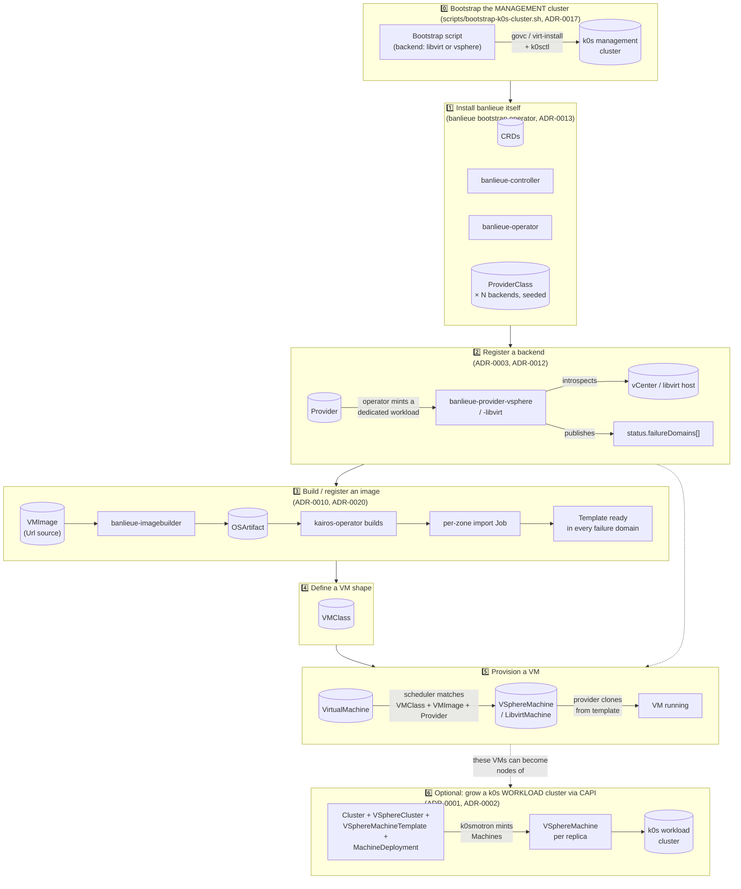

# Guide: End-to-End Setup — Bootstrap to Running VMs

Every other guide in this section zooms into **one** step of the pipeline.
This page is the map: it walks the whole chain, from "nothing exists yet"
to a running VM (and, optionally, that VM joining a k0s cluster), and links
out to the guide that covers each step in depth.



> Steps 3 and 5 are drawn for both backends to show the target shape. Only
> the vSphere path is fully wired end-to-end today: `banlieue-provider-libvirt`
> handles registration + image import (steps 2–3) but has no
> `LibvirtMachine` reconciler yet, so step 5 only clones/powers on a real VM
> on vSphere. See [Project status](../index.md#project-status).

## Walkthrough

### 0. Bootstrap the management cluster

!!! tip "Starting from bare metal?"
    `bootstrap-k0s-cluster.sh` assumes its substrate already exists — a working
    `libvirtd` with storage pools, or a reachable vCenter plus `govc`. If you
    are starting from a machine with nothing on it, do
    [Host Bootstrap](host-bootstrap.md) first.

Before any of banlieue's own CRDs exist, *something* has to run the cluster
banlieue's controllers will live on. `scripts/bootstrap-k0s-cluster.sh`
does this the old-fashioned way — no banlieue CRDs involved yet, because
banlieue doesn't exist in this cluster yet:

- **`libvirt` backend** — clones/installs Kairos VMs via `virt-install` on
  a KVM host.
- **`vsphere` backend** — clones cluster-specific Kairos templates via
  `govc`, spreading nodes evenly across compute clusters so each is its own
  etcd failure domain.
- Either way, [k0sctl](https://github.com/k0sproject/k0sctl) installs k0s
  onto the resulting VMs. An opt-in `flux` step (`FLUX_ENABLED=true`) pulls
  a registry credential from HashiCorp Vault and pushes
  `flux-operator`/`flux-core` manifests onto the first controller node.

No environment-specific identifier is ever committed — every value comes
from the `GOVC_*` environment, `govc` discovery, or an untracked operator
config (ADR-0017, ADR-0018).

```sh
./scripts/bootstrap-k0s-cluster.sh --help
```

#### vSphere

```sh
# Scaffold the untracked env file (BACKEND must be set explicitly — it
# defaults to libvirt otherwise, even for this template-only step)
BACKEND=vsphere ./scripts/bootstrap-k0s-cluster.sh --print-env-template \
  > ~/.k0s/banlieue.env

# Fill in the node table (name/cluster/ip/role) and per-cluster placement
# maps (VSPHERE_RP / VSPHERE_DSC / VSPHERE_NET / VSPHERE_TPL), then:
BANLIEUE_ENV_FILE=~/.k0s/banlieue.env BACKEND=vsphere \
  ./scripts/bootstrap-k0s-cluster.sh all
```

Subcommands run individually: `vms | config | apply | kubeconfig | label |
flux | destroy`. `GOVC_*` (URL/creds/datacenter/CA) comes from the ambient
environment; nothing environment-specific is ever committed to the env file
(`rules/no-real-infrastructure.md`).

#### libvirt backend (default): nodes on Cloud Hypervisor

```sh
CH_FIRMWARE=/opt/banlieue/firmware/<version>/CLOUDHV.fd \
VM_COUNT=4 VCPUS=2 MEM_MB=8192 DISK_GB=25 \
  ./scripts/bootstrap-k0s-cluster.sh all
```

Run on the KVM host itself, with passwordless `sudo`. Each node is a Cloud
Hypervisor VM by default ([below](#nodes-on-cloud-hypervisor-adr-0099)),
on the bridge of libvirt's `default` network unless you name one. Kairos
installs itself from `IMAGE_URL`'s ISO onto an empty disk before `k0sctl`
takes over.

`DEFAULT_VMM=libvirt` makes every node a libvirt domain instead, created
with `virt-install`; `LIBVIRT_URI` may then point at a remote host, and no
firmware or `sudo` is needed:

```sh
DEFAULT_VMM=libvirt LIBVIRT_URI=qemu:///system \
VM_COUNT=4 VCPUS=2 MEM_MB=8192 DISK_GB=25 \
  ./scripts/bootstrap-k0s-cluster.sh all
```

#### libvirt: a long-lived cluster (kine, bridge, Kairos on Debian)

For a management cluster you keep, three options change what the defaults
give you (ADR-0085), and a fourth puts the control plane behind a virtual IP
(ADR-0086). Put them in an untracked env file
(`BANLIEUE_ENV_FILE`), since one holds a password:

```sh
# Kairos v4 ships ISOs only for Hadron; build one on Debian 13 instead.
OUT_DIR=$HOME/builds/kairos-iso ./scripts/build-kairos-debian-iso.sh
```

```sh
# ~/.config/banlieue/hosts/<name>.env  (never committed)
LIBVIRT_IMAGE_KIND=kairos
BASE_IMAGE_PATH=$HOME/builds/kairos-iso/<the ISO it printed>
IMAGE_SHA256=<the digest it printed>

# Nodes on a host bridge, with addresses from the LAN's DHCP. Fixed MACs
# let the DHCP server reserve each node's address.
LIBVIRT_BRIDGE=br0
VM_MACS="52:54:00:00:00:01 52:54:00:00:00:02 52:54:00:00:00:03"

# Cluster state in PostgreSQL through kine, instead of etcd on the nodes.
K0S_STORAGE_TYPE=kine
KINE_DATASOURCE="postgres://k0s:<password>@db.example.com:5432/k0s?sslmode=require"

# A free LAN address for the API, outside DHCP and every MetalLB pool.
API_VIP=192.0.2.10/24
```

```sh
BANLIEUE_ENV_FILE=~/.config/banlieue/hosts/<name>.env \
VM_COUNT=3 NODE_ROLES="controller+worker controller+worker controller+worker" \
  ./scripts/bootstrap-k0s-cluster.sh all
```

| Setting | Default | Effect |
| --- | --- | --- |
| `LIBVIRT_BRIDGE` | empty (use `LIBVIRT_NETWORK`) | Attach the VMs to this host bridge. Their addresses are read from the guest agent (the Debian ISO carries `qemu-guest-agent`), then the host's neighbour table. |
| `VM_MACS` | empty (libvirt picks) | One MAC per VM, in order. Reserve them in your DHCP server: k0s nodes must not change address. |
| `K0S_STORAGE_TYPE` | `etcd` | `kine` stores cluster state in the database `KINE_DATASOURCE` names. |
| `KINE_DATASOURCE` | none | The kine data source, password included. The generated `k0sctl.yaml` is written `0600`. |
| `API_VIP` | none; **required** with more than one controller | A virtual IP (`address/prefix`) keepalived floats between the controllers. k0s's reverse proxy on the holder balances the API over every controller. It becomes `externalAddress`, a certificate SAN and the kubeconfig server. With `TAILSCALE_AUTHKEY`, each node advertises it as a `/32` subnet route. |
| `API_VIP_ROUTER_ID` | `51` | VRRP virtual router ID. Must be unique on the LAN. |
| `API_VIP_AUTH_PASS` | generated into `$WORKDIR/api-vip-authpass` | VRRP password (up to 8 letters or digits), identical on every controller. It prevents collisions between clusters; it is not authentication. |
| `NO_API_VIP` | `false` | `true` accepts a multi-controller cluster with one controller as its only entry point. |
| `K0S_DISABLE_KONNECTIVITY` | `true` | Konnectivity's agents can only hold connections to one controller, which breaks webhooks, `metrics.k8s.io` and `kubectl logs` on the others. Both backends build flat networks where it is not needed. |

The database is then the cluster's single point of failure, and its backups
are the cluster's backups. The API itself survives losing any one
controller: the VIP moves, and the `kubernetes` Service lists every
controller.

If the tailnet routes are not auto-approved, approve `<VIP>/32` once per node
in the Tailscale admin console. Clients off the LAN reach the VIP through
whichever node is up.

##### Converting an existing cluster to a VIP

A cluster built before ADR-0086 has its first controller as
`externalAddress` and konnectivity running. Setting `API_VIP` and rerunning
`config` then `apply` rewrites each controller's `k0s.yaml` and, through
k0sctl's reinstall phase, its install flags. Two steps remain by hand:

1. Remove what konnectivity left behind. k0s stops managing the stack but
   does not delete it, and removing its manifest directory does not prune it
   either. On **every** controller, move the directory away so a restart
   cannot reapply it:
   `sudo mv /var/lib/k0s/manifests/konnectivity /var/lib/k0s/konnectivity-manifests.removed`
   Then delete the objects the stack created (label
   `k0s.k0sproject.io/stack=konnectivity`):

   ```sh
   kubectl -n kube-system delete daemonset/konnectivity-agent serviceaccount/konnectivity-agent
   kubectl delete clusterrolebinding system:konnectivity-server
   ```
2. Point existing kubeconfigs, and the host-resident providers'
   `/etc/banlieue/credentials/kubeconfig`, at the VIP.

Check the result with `kubectl get endpointslices -n default -l
kubernetes.io/service-name=kubernetes`, which should list every controller,
and `kubectl get apiservice v1beta1.metrics.k8s.io`, which should stay
`True`.

##### Nodes on Cloud Hypervisor (ADR-0099)

Cloud Hypervisor is the default VMM. `DEFAULT_VMM` sets it for every node,
and `NODE_VMMS` overrides it per node: one entry per VM, in order, beside
`NODE_ROLES` and `VM_MACS`, so one cluster can mix both. A
`cloud-hypervisor` node is a plain Cloud Hypervisor VM, not a
banlieue `VirtualMachine`: a management node must come up after a host
reboot before the cluster banlieue runs on exists, so banlieue cannot be
what starts it. The script writes three systemd units for it on the host:

| Unit | Runs as | Does |
| --- | --- | --- |
| `k0s-vm-<name>-net.service` | root, oneshot | Creates tap `kv-<name>` on the bridge, owned by `CH_VM_USER`, so the VMM needs no `CAP_NET_ADMIN`. Deletes it on stop. |
| `k0s-vm-<name>-swtpm.service` | `CH_VM_USER` | The node's vTPM (`CH_TPM=true`), matching the TPM virt-install gives a UEFI domain. |
| `k0s-vm-<name>.service` | `CH_VM_USER` | `cloud-hypervisor` with the node's disk, seed, tap, vTPM and firmware. Enabled, so it starts at boot like an autostarted domain. Stopping it presses the ACPI power button and waits for the guest to power off, up to 120 s; a guest still booting ignores the button and is then terminated. |

The install matches the libvirt Kairos path: the installer ISO is attached
through a drop-in under `/run/systemd/system`, Kairos installs and powers
off, and the script detaches the ISO and enables the unit. A
`LIBVIRT_IMAGE_KIND=cloud` image boots directly.

```sh
# Three Cloud Hypervisor controllers on a LAN bridge, on one host.
VM_COUNT=3
NODE_ROLES="controller+worker controller+worker controller+worker"
VM_MACS="52:54:00:00:00:01 52:54:00:00:00:02 52:54:00:00:00:03"
LIBVIRT_BRIDGE=br0
CH_FIRMWARE=/opt/banlieue/firmware/<version>/CLOUDHV.fd
```

| Setting | Default | Effect |
| --- | --- | --- |
| `DEFAULT_VMM` | `cloud-hypervisor` | The VMM of every node `NODE_VMMS` does not name: `cloud-hypervisor` or `libvirt`. |
| `NODE_VMMS` | empty (every node `DEFAULT_VMM`) | `libvirt` or `cloud-hypervisor` per VM. More entries than `VM_COUNT`, or another value, is refused. |
| `CH_FIRMWARE` | none; **required** | The `CLOUDHV.fd` to boot. `banlieue host cloud-hypervisor install` puts one under `/opt/banlieue/firmware/`. |
| `CH_BRIDGE` | `LIBVIRT_BRIDGE`, else `LIBVIRT_NETWORK`'s bridge | Bridge for the node's tap. It must carry a host IPv4 address (see below). On libvirt's `default` network that is `virbr0`, whose DHCP server gives the nodes their addresses. |
| `CH_BINARY` / `CH_REMOTE` | `/usr/local/bin/cloud-hypervisor`, `/usr/local/bin/ch-remote` | The VMM, and the client the stop command uses. A vTPM needs a VMM with the fix tracked in cloud-hypervisor#9053. |
| `CH_VM_USER` | `k0s-vm` | System account (no login, `kvm` group, no capabilities) that runs every CH node's VMM and vTPM. Created on first use. |
| `CH_VM_DIR` | `<libvirt pool dir>/../k0s-ch` | One directory per node: `disk.qcow2`, `seed.iso`, `tpm/`. Every parent must be searchable by `CH_VM_USER`. |
| `CH_TPM` | `true` | Give each CH node a vTPM. Needs `swtpm` (`SWTPM`). |

**A cluster built on libvirt** (before Cloud Hypervisor became the default)
sets `DEFAULT_VMM=libvirt` in its env file. Until it does, every command
refuses to run, `destroy` included, and names that setting: without it,
`vms` would build a Cloud Hypervisor node beside each libvirt domain, with
the same name and MAC, and `destroy` would leave every domain running. The
same check refuses a libvirt node whose name is already a Cloud Hypervisor
node on the host.

Requirements and differences from a libvirt node:

- The script runs **on the hypervisor host** and needs **passwordless sudo**
  for CH nodes (it writes units and owns files as `CH_VM_USER`). A remote
  `LIBVIRT_URI` is refused for them.
- There is no guest agent. Each CH node's seed pings the host's address on
  the bridge at every boot, and the script reads the node's address from the
  host's neighbour table by its MAC. Without `VM_MACS` the MAC is derived
  from the cluster and node name; reserve it in DHCP either way.
- The guest's NIC is always `ens2`: the script pins it to PCI slot 2, so
  the name does not move with the disks or the installer ISO. This needs a
  Cloud Hypervisor whose `--net` takes `pci_device_id`; an older one is
  refused. A node built before this change keeps its old name (`ens3`)
  until its VMM unit is next restarted.
- The node is invisible to `virsh` and to Cockpit's Virtual Machines page,
  which only drives libvirt's QEMU driver. Use `systemctl status
  k0s-vm-<name>`; the serial console is `/run/k0s-vm-<name>/serial.sock`
  (`sudo socat -,raw,echo=0 UNIX-CONNECT:/run/k0s-vm-<name>/serial.sock`).
- `destroy` removes CH nodes too: it kills the VMM (a power cut, like `virsh
  destroy`), removes the units and deletes the node's directory.
- An install that was interrupted (the script killed, the host rebooted) is
  redone by the next `vms`: a node with units but no `.installed` marker is
  removed on its own and installed again. Only that node is touched.

##### Adding a node to a running cluster (ADR-0099)

`config` regenerates the whole k0sctl configuration from the script's
settings, and `apply` pushes it to every node, controllers included. A
cluster you have changed since bootstrap (a VIP added by hand, an API server
flag, a component disabled) gets those changes overwritten. To grow such a
cluster, use `join` instead:

```sh
# The cluster's env file describes three nodes. A second untracked file
# describes the fourth and names it for `join`:
cat >mgmt-04.env <<'EOF'
VM_COUNT=4
NODE_ROLES="controller+worker controller+worker controller+worker worker"
VM_MACS="52:54:00:00:00:01 52:54:00:00:00:02 52:54:00:00:00:03 52:54:00:00:00:04"
JOIN_NODES=mgmt-04
EOF

# Source both (the second wins), create the node, then join only it.
set -a; . ~/.config/banlieue/hosts/<name>.env; . ./mgmt-04.env; set +a
./scripts/bootstrap-k0s-cluster.sh vms
./scripts/bootstrap-k0s-cluster.sh join
```

`vms` leaves existing VMs alone (it only starts them if stopped). `join`
adds each node in `JOIN_NODES` in its `NODE_ROLES` role:

1. checks the controller runs `K0S_VERSION`, and refuses a mismatch;
2. stages that k0s binary, checksum-verified, under `/opt/k0s` on the node;
3. mints a token of the node's role on a controller (`JOIN_CONTROLLER`,
   default the first one) that expires after `JOIN_TOKEN_EXPIRY` (`15m`),
   and carries it over SSH into a root-only file on the node, never onto
   your machine;
4. runs `k0s install worker`, or `k0s install controller` for a
   controller, and waits for the node to report `Ready` (a controller first
   registers as a `ControlNode`).

It never reads `k0sctl.yaml` and writes nothing to an existing controller.
A node already running its role's k0s service is skipped.

**A joining controller is a copy of a running one**, not of your settings,
so the storage, VIP and API server configuration you changed after
bootstrap carry over:

- `/etc/k0s` is copied from `JOIN_CONTROLLER` (or the first controller),
  node to node through one pipe, without join tokens or the per-worker
  `containerd.toml`. That is `k0s.yaml` and whatever it names: a datastore
  CA bundle, an authentication configuration. Stray backups beside them are
  copied too.
- The install flags are that controller's (from `systemctl cat
  k0scontroller`), such as `--disable-components=konnectivity-server`.
  Only the worker flags change: `--enable-worker` for `controller+worker`,
  plus `--no-taints` when `NO_TAINTS=true`.

Before joining a controller, let the systems outside the cluster accept
it: with kine, the datastore must admit the new node's address (on
PostgreSQL, a `hostssl` line in `pg_hba.conf` and a reload), and anything
else keyed on the controllers' addresses, such as other databases' access
rules or firewalls, needs the new one too. `join` cannot do that; the
controller just never registers, and the message points at its journal.

A node that already runs k0s in another role is refused. Converting a
worker to a controller destroys its k0s state, so you run the reset
yourself (`sudo k0s stop && sudo k0s reset && sudo reboot` on the node),
delete its Node (`kubectl delete node <name>`), then `join` again. `join`
refuses a controller while a Node of that name exists: kubelet sets a
Node's labels only when it registers it, so the old worker's Node would
never get `node-role.kubernetes.io/control-plane`.

###### Swapping a libvirt node for a Cloud Hypervisor one

Replace one node at a time, adding before removing, so a three-controller
control plane never runs on two:

1. Create the CH node as a controller and join it (above): give it the
   same role as the node it replaces.
2. Check it serves: `kubectl get controlnodes` lists it, and its node is
   `Ready`. With `API_VIP`, it is now also a VRRP candidate for the VIP.
3. Retire the old node: `kubectl drain <old> --ignore-daemonsets
   --delete-emptydir-data`, then on it `sudo k0s stop && sudo k0s reset`,
   then `kubectl delete node <old>` and `kubectl delete controlnode <old>`.
   **Save its local volumes first.** A volume of a node-local storage class
   (such as `local-path`) lives on the node's disk and is pinned to the
   node's name, so it dies with the VM. List them with `kubectl get pv`
   (look at each one's node affinity); after the drain, copy their
   directories off the node (`sudo tar -C /opt -cpf - local-path-provisioner`
   for `local-path`) and, once the new VM is up but **before** `join`,
   restore them with `tar -xpf` so ownership and modes come back too.
   Without that, the pod is rescheduled onto the new node of the same name
   with an empty directory the kubelet creates as `root 0755`, which a
   non-root pod cannot write.
4. Remove its VM (`virsh destroy` and `virsh undefine --nvram <old>`) and
   its disk, its datastore access line and its DHCP reservation.
5. Add it to `RETIRED_NODES` in the env file.

Nodes are named by position (`<VM_PREFIX>-01` is the first entry of
`NODE_ROLES`, `VM_MACS` and `NODE_VMMS`), so a retired node keeps its
entry; deleting it would rename every node after it. `RETIRED_NODES` is
what stops `vms` recreating it as an empty VM and `join` waiting for its
address. Keep growing the list as the swap goes on:

```sh
VM_COUNT=5
NODE_ROLES="controller+worker controller+worker controller+worker controller+worker controller+worker"
NODE_VMMS="libvirt libvirt libvirt cloud-hypervisor cloud-hypervisor"
RETIRED_NODES="mgmt-01"
JOIN_NODES=mgmt-05
```

**Rebuilding a node in place** keeps its name, MAC and address instead of
adding new ones: add one extra controller first, so the control plane keeps
its size while a node is out, then for each node retire it (step 3, then
remove its libvirt domain), flip its `NODE_VMMS` entry to
`cloud-hypervisor`, run `vms`, restore its local volumes, and `join` it.
The DHCP reservation brings it back on its old address. Once every node is
swapped, retire the extra controller and set the env file to
`DEFAULT_VMM=cloud-hypervisor` (or drop `NODE_VMMS` and `DEFAULT_VMM`).
The installer's lease for the same MAC can linger in the host's neighbour
table as a `STALE` entry; the script finds the node by its live entry.

Do not run `config` + `apply` against a swapped cluster: the k0sctl
configuration would describe nodes and settings it no longer has.

The two files are sourced with `set -a` rather than passed as
`BANLIEUE_ENV_FILE`, because the script sources that file **after** reading
the environment: a `VM_COUNT` in it would win over one on the command line.

**Output of this phase:** a running k0s **management** cluster with nothing
banlieue-specific on it yet.

### 1. Install banlieue

`banlieue bootstrap operator` (ADR-0013) — same binary, `bootstrap`
subcommand — applies, in order: namespace → CRDs (built at runtime from the
binary's own Rust types, so schema and binary can never disagree) →
`banlieue-controller` → `banlieue-operator` → one `ProviderClass` per
backend compiled into the binary. `--dry-run` prints the exact YAML instead
of applying it, for a GitOps repo.

Without the binary, every GitHub Release carries that `--dry-run` output as
`install.yaml`. It includes `ProviderClass` objects, so establish the CRDs
first:

```sh
URL=https://github.com/firestoned/banlieue/releases/latest/download   # or releases/download/<tag>
kubectl apply --server-side -f $URL/crds.yaml
kubectl wait --for=condition=Established --timeout=60s -f $URL/crds.yaml
kubectl apply --server-side -f $URL/install.yaml
```

| Release asset | Contents |
| --- | --- |
| `install.yaml` | `banlieue bootstrap operator --version <tag> --dry-run` |
| `crds.yaml` | every CRD (also inside `install.yaml`) |
| `admission-policies.yaml` | every policy in `deploy/admission/`; opt-in, and **edit its two parameter ConfigMaps first** (see `deploy/admission/README.md`) |
| `network-policies.yaml` | every policy in `deploy/network-policies/` (ADR-0094); opt-in, applied per namespace |
| `deploy-manifests.tar.gz` | the whole `deploy/` tree, READMEs and host units included |
| `infrastructure-components.yaml`, `metadata.yaml` | the clusterctl provider ([Cluster API](cluster-api.md)) |

All of them are listed in `checksums.sha256` and covered by the release's
SLSA provenance (`banlieue-<version>.intoto.jsonl`).

**Output:** CRDs installed, two controllers running, zero backends
registered yet. See **[Core Controller](core-controller.md)**.

### 2. Register a backend

Apply a `Provider` (endpoint, credentials, declared storage/network
classes). `banlieue-operator` mints a dedicated Deployment + ServiceAccount
+ Role + RoleBinding for it (one per `Provider`, so a hung backend never
stalls another — ADR-0003), and that pod logs in, introspects the backend,
and publishes `status.failureDomains[]`.

**Output:** one or more reachable failure domains, ready for scheduling.
See **[vSphere Provider](vsphere-provider.md)** /
**[libvirt Provider](libvirt-provider.md)**, and
**[Environment / Provider Isolation](environment-provider-isolation.md)**
before you reach for a *second* `Provider` for what's actually the same
backend.

### 3. Build or register an image

A `VMImage` with a `Template`/`BackingFile` source just needs the named
template/file to already exist on the backend — the provider verifies it.
A `Url` source (an OCI-referenced Kairos image) triggers the actual build
pipeline: `banlieue-imagebuilder` requests an `OSArtifact` from
[kairos-operator](https://kairos.io), and once it's `Ready`, each matching
provider fans out **one import Job per failure domain**, turning the
built artifact into a template/volume in every zone.

**Output:** a template (or raw disk) available in every failure domain a
matching `VMClass` could schedule onto. See
**[Using banlieue-imagebuilder](using-banlieue-imagebuilder.md)** and
**[Setting up the Kairos Operator](kairos-operator-setup.md)**.

### 4. Define a VM shape

A `VMClass` names a hardware tier (CPU/memory/disks) plus the *abstract*
storage/network classes a `Provider` must satisfy — no backend-specific
field. It's shared by every `VirtualMachine` that wants this shape, and
(since [ADR-0030](https://github.com/firestoned/banlieue/blob/main/docs/adr/0030-per-zone-capability-targets.md))
portable across every cluster of a `Provider`, and across multiple
`Provider`s, without being rewritten per zone.

### 5. Provision a VM

A `VirtualMachine` references a `classRef`/`imageRef` and (optionally)
placement constraints. `banlieue-controller` resolves the scheduling
decision and server-side-applies the backend-specific infra CR
(`VSphereMachine` today; a `LibvirtMachine` is the design target but not
implemented yet — see [libvirt Provider](libvirt-provider.md)) owned by the
`VirtualMachine`, and that provider clones a real VM from the template
resolved in step 3.

**Output:** a running VM, with `VirtualMachine.status` mirroring the infra
CR's own status. See **[vSphere Provider](vsphere-provider.md)** step 6.

### 6. Optional: use these VMs as a k0s workload cluster

Nothing above required Cluster API. If you *do* want CAPI-driven
replication — "N replicas spread across failure domains" — apply a CAPI
`Cluster` + `VSphereCluster` (an `InfraCluster`, aggregating the selected
`Provider`s' failure domains) + `VSphereMachineTemplate` +
`MachineDeployment`, and a control-plane provider (k0smotron for k0s).
CAPI mints one `Machine` per replica; banlieue's `VSphereMachine`
reconciler realizes each exactly as it would for a hand-applied one.
banlieue ships **no native replica/tier controller of its own** — that's a
deliberate non-negotiable (ADR-0001): cluster-level replica management is
CAPI's job, not banlieue's, so the same provider can serve *any* CAPI
consumer (kubeadm, RKE2, k0smotron), not just banlieue's own
`VirtualMachine`.

See **[Infrastructure CRDs & CAPI](../concepts/infra-crds-capi.md)**.

## Why phase 0 is not "banlieue all the way down"

It's a fair question: doesn't the management cluster itself need VMs, and
couldn't banlieue provision *those*? It could, in principle — but at that
point in time there is no Kubernetes cluster for banlieue's controllers to
run *on* yet, so there's no CRD API to apply a `VirtualMachine` against.
Phase 0 is deliberately the one piece that talks to `govc`/`virt-install`
directly, precisely so it has no circular dependency on the thing it's
building. Once the management cluster exists, everything from phase 1
onward — including, if you choose, a *second*, CAPI-provisioned k0s
cluster in phase 6 — goes through banlieue's own CRD-only contract.

## Full detail, phase by phase

| Phase | Guide |
| --- | --- |
| 0 — Bootstrap | `scripts/bootstrap-k0s-cluster.sh --help`; ADR-0017, ADR-0018 |
| 1 — Install banlieue | [Core Controller](core-controller.md) |
| 2 — Register a backend | [vSphere Provider](vsphere-provider.md), [libvirt Provider](libvirt-provider.md), [Provider Lifecycle & Install](provider-lifecycle.md), [Environment / Provider Isolation](environment-provider-isolation.md) |
| 3 — Build an image | [Using banlieue-imagebuilder](using-banlieue-imagebuilder.md), [Setting up the Kairos Operator](kairos-operator-setup.md), [Building an Alpine VM Template](alpine-vsphere-template.md), [Building a Kairos Hadron VM Template](building-kairos-hadron-template.md) |
| 4 / 5 — VMClass / VirtualMachine | [vSphere Provider](vsphere-provider.md) steps 4–7 |
| 6 — CAPI workload cluster | [Infrastructure CRDs & CAPI](../concepts/infra-crds-capi.md) |

Every field of every CRD used along the way: **[API Reference](../reference/api.md)**.
