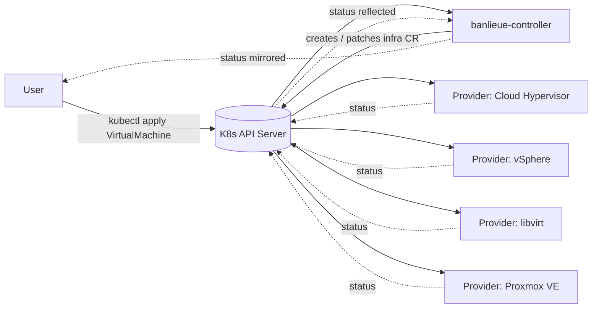

# banlieue

> **Pronunciation:** IPA `/bɑ̃.ljø/` — "bohn-lyuh": a nasalized "bon" (as in
> French "blanc") followed by "lyuh" with a rounded French **u** (like
> German ü, or French "tu").

> A Kubernetes-native, **provider-agnostic** virtualization API.
> One CRD. Many backends. No touching the user's workflow when you swap them.

[](https://github.com/firestoned/banlieue/actions/workflows/build.yaml)
[](reference/license.md)
[](https://www.rust-lang.org/)
[](https://github.com/firestoned/banlieue)

---

## What is banlieue?

**banlieue** lets a Kubernetes user declare a virtual machine in the same way they
declare a `Deployment` or `Service`:

```yaml
apiVersion: banlieue.io/v1alpha1
kind: VirtualMachine
metadata:
  name: db-prod-01
spec:
  classRef:
    name: db-prod-large       # references a VMClass
  imageRef:
    name: ubuntu-22-04         # references a VMImage
  placement:
    providerSelector:
      matchLabels: { dc: dc1, env: prod }  # which Provider(s) may schedule this VM
```

That single CR is then **scheduled** onto whichever `Provider` matches
`placement.providerSelector` and knows how to talk to a real backend:
**Cloud Hypervisor** on your own KVM hosts (the reference backend),
**vSphere**, **libvirt** or **Proxmox VE**, or any other backend a third
party writes, without changing the user's manifest.

## Why does banlieue exist?

Because the **VM control plane is fragmented**, and every team that runs more than
one hypervisor ends up writing the same glue twice. The reasoning behind the
project — the abstraction philosophy, the "least-touch on the user workflow"
principle, the deliberate choice to keep providers behind CRDs instead of RPC —
is the subject of the [Why banlieue?](reasoning/index.md) section. Start there if
you want to understand the design before the code.

The short version:

- **One declarative API** for VMs, regardless of backend.
- **Swap or mix providers** without rewriting workloads: Cloud Hypervisor on bare-metal KVM hosts, vSphere in the data centre, libvirt or Proxmox at the edge, all in the same cluster.
- **Zero new transports**: the contract between the controller and providers is the Kubernetes API itself. No gRPC, no REST, no custom auth.
- **Reuses an existing, battle-tested status model**: provider CRDs satisfy the [Cluster API v1beta2 InfraMachine contract](https://cluster-api.sigs.k8s.io/developer/providers/contracts/).

## What banlieue is **not**

- Not a hypervisor.
- Not a "lift-and-shift" tool that pretends VMs are containers (see Kubevirt for that).
- Not a CAPI replacement — banlieue happily coexists with CAPI but does not depend on it.
- Not a closed system: providers are a documented contract; anyone can write one.

See [Non-Goals](reasoning/non-goals.md) for the full list.

## How it works (one diagram)



The main controller never speaks directly to a provider. Both sides watch the
Kubernetes API; that is the bus. See [Architecture](concepts/architecture.md) and
[CRD-Only Contract](reasoning/crd-only-contract.md).

## Cloud Hypervisor first

Every backend runs the same `VirtualMachine`, but one is the reference:
**Cloud Hypervisor**, a small Rust VMM, on a plain KVM host with no
hypervisor daemon. Its provider runs on the host and holds no hypervisor
credential and no Secret; each guest is a systemd unit with its own uid;
all guests share a budget the scheduler places VMs against; images arrive
from an OCI registry by digest; and a warm pool refills a claimed
`GuestReady` VM in about 100 to 120 s. Start with the
[Cloud Hypervisor Provider guide](guides/cloud-hypervisor-host.md), and see
the [Provider Comparison](reference/provider-comparison.md) for how it
lines up against vSphere, libvirt and Proxmox.

## Project status

banlieue is **early, and runs real VMs on all four backends**. The type
system and CRDs, the main controller, `banlieue-operator`,
`banlieue-imagebuilder`, warm `VirtualMachinePool`s and `VirtualMachineClaim`s
are in place, and so is each provider:

| Provider | State |
| --- | --- |
| Cloud Hypervisor | Complete: host install, VM lifecycle, vTPM, OCI images, pools, capacity-aware placement |
| vSphere | Complete: validated end to end against real vCenter and ESXi |
| libvirt | Complete: VM lifecycle, NoCloud cloud-init, vTPM, pools |
| Proxmox VE | Implemented end to end and tested against a real node; the cluster end-to-end test is the last item |

Live migration and snapshots are not started. Phase plans and their status
are in [`ROADMAPS.md`](https://github.com/firestoned/banlieue/blob/main/ROADMAPS.md).

The CRD surface is `v1alpha1` and will break before `v1`. Don't run production
workloads against it yet.

## Where to go next

- [Overview — what banlieue does, fundamentally](overview.md) ← start here
- [Why banlieue? — the case for this project](reasoning/index.md)
- [Cloud Hypervisor Provider: a bare-metal host to running VMs](guides/cloud-hypervisor-host.md)
- [Guides: install banlieue and every backend](guides/index.md)
- [Architecture](concepts/architecture.md)
- [Developer — build from source & local dev](developer/local-development.md)
- [License](reference/license.md)

## Community & support

- **GitHub Issues**: <https://github.com/firestoned/banlieue/issues>
- **GitHub Discussions**: <https://github.com/firestoned/banlieue/discussions>

## License

banlieue is open-source software, licensed under the [Apache License 2.0](reference/license.md).
