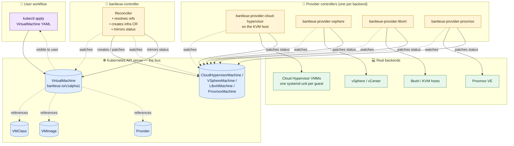

# Overview

> **What banlieue does, in one sentence:** it gives you a single
> Kubernetes-native API for describing virtual machines, then dispatches each
> VM to whichever hypervisor backend you've plugged in (Cloud Hypervisor on
> your own KVM hosts, vSphere, libvirt, Proxmox VE, or one you write
> yourself) without your manifest ever changing shape.

This page is the **fundamentals**: what banlieue is, what it does, and how the
pieces fit together at a single glance. For the *reasoning* behind these
choices, see [Why banlieue?](reasoning/index.md). For the wiring, see
[Architecture](concepts/architecture.md).

## The fundamental idea

There are three actors:

| Actor | What they do |
| --- | --- |
| **User** | Writes one `VirtualMachine` YAML. Runs `kubectl apply`. That's it. |
| **banlieue controller** | Watches `VirtualMachine`s, resolves their refs, creates a backend-specific *infrastructure* CR, and mirrors status back. |
| **Provider controller** | Watches its infrastructure CR and talks to a real hypervisor (Cloud Hypervisor / vSphere / libvirt / Proxmox VE / …). |

Everything happens through the **Kubernetes API**. There is no second protocol,
no RPC, no message bus. CRDs are the messages. The K8s API server is the bus.

## High-level diagram



Three rules to remember when reading the diagram:

1. **Solid arrows are reads/writes against the K8s API.** That's the *only*
   form of communication between any two controllers.
2. **Dashed arrows are watches or references** — they exist in the data, not
   on a network wire.
3. **The user only ever interacts with the top-left box.** Everything else is
   plumbing they shouldn't have to see.

> **One provider is not a pod.** The Cloud Hypervisor provider runs on the KVM
> host itself, as a systemd service, and dials the API server; nothing dials
> the host. To the diagram that makes no difference: it watches its
> `CloudHypervisorMachine`s and patches their status like every other
> provider. All four infrastructure CRs are reconciled today; see
> [Project status](index.md#project-status).

## A 10-second walkthrough

1. The user writes:

    ```yaml
    apiVersion: banlieue.io/v1alpha1
    kind: VirtualMachine
    metadata:
      name: db-prod-01
    spec:
      classRef:
        name: db-prod-large
      imageRef:
        name: ubuntu-22-04
      placement:
        providerSelector:
          matchLabels: { dc: dc1, env: prod }
    ```

2. The **banlieue controller** sees it, looks up `db-prod-large` and
   `ubuntu-22-04`, matches `placement.providerSelector` against the available
   `Provider` CRs to pick one (here, a Cloud Hypervisor host), and creates a
   `CloudHypervisorMachine` carrying the resolved spec.

3. The **Cloud Hypervisor provider**, running on that host, sees the new
   `CloudHypervisorMachine`, prepares the guest's disk and seed, starts its
   VMM as a systemd unit under the guest's own uid, and writes status
   (`Ready=true`, addresses, provider ID) back onto the
   `CloudHypervisorMachine`. On vSphere the same step is a `VSphereMachine`
   and a clone in vCenter.

4. The **banlieue controller** sees that status and mirrors it onto
   `VirtualMachine.status` so the user can `kubectl get vm db-prod-01` and
   see `READY=true`.

If the user later changes `placement.providerSelector` to match a different
`Provider`, the same sequence happens — but now that Provider's backend
controller picks up the work, on the same Kubernetes API, with the same
status contract. Every backend has its infrastructure CR and reconciler, so
the swap works between any two of them; see
[Project status](index.md#project-status).

## What "fundamentally" buys you

Because everything below the user's CR is uniform and pluggable:

- **Swap a backend** by changing one field (`placement.providerSelector`).
- **Mix backends** in one cluster (sandboxes and pools on Cloud Hypervisor
  hosts, prod on vSphere, dev on libvirt, edge on Proxmox), addressed by the
  same `kind: VirtualMachine`.
- **Add a new backend** by writing a provider once; every existing
  `VirtualMachine` becomes deployable there with no manifest change.
- **Audit, RBAC, GitOps, OPA, dashboards, etc.** all work the same way they
  work for any Kubernetes resource — no special tooling.

These properties are not features bolted onto banlieue. They are *consequences*
of two design choices: the [abstraction principle](reasoning/abstraction-principle.md)
and the [CRD-only contract](reasoning/crd-only-contract.md). If you only have
time to read two pages of *Why banlieue?*, read those.

## Warm pools and single-use sandboxes

One class of VM cannot be provisioned on demand at all. A disk sealed to a
per-VM vTPM can only be produced by letting the guest install itself on first
boot with its own TPM attached ([ADR-0040](https://github.com/firestoned/banlieue/blob/main/docs/adr/0040-deferred-install-for-vtpm-encryption.md)),
which costs minutes — and the slowness *is* the security property, so no
provisioning cleverness removes it. The only way to hand such a VM over
quickly is to have installed it already.

Two more kinds cover that, built on the same uniform substrate as everything
above:

- **[`VirtualMachinePool`](guides/virtualmachine-pools.md)** maintains a warm
  set: it refills as members leave, reaps ones poisoned mid-install, and rolls
  the set when the image is rebuilt. It creates nothing but ordinary
  `VirtualMachine`s — which is why there is no `VSpherePool` or `LibvirtPool`
  and never will be.
- **[`VirtualMachineClaim`](guides/virtualmachine-claims.md)** hands one member
  to one subject, **once**. There is no unbind and no return-to-pool: the VM
  itself is the isolation boundary between subjects, so release is always
  deletion, and deleting a claim blocks until the backend VM is really gone.

That pair is what makes banlieue usable as a sandbox substrate for CI jobs and
AI agents. Both are implemented and validated end-to-end against a real libvirt
host. The claim is the top of banlieue's API
([ADR-0097](https://github.com/firestoned/banlieue/blob/main/docs/adr/0097-api-ends-at-virtualmachineclaim.md)):
agent-specific layers such as `AgentSandbox` live in
[mediatore](https://github.com/firestoned/mediatore).

## What banlieue is **not**

- Not a hypervisor — it does not run VMs, it drives existing hypervisors.
- Not [Kubevirt](https://kubevirt.io/) — VMs do not run as pods on K8s nodes.
- Not [CAPI](https://cluster-api.sigs.k8s.io/) — banlieue's `VirtualMachine`
  is not a `clusterv1.Machine`; the two coexist and even share providers, but
  banlieue's user-facing API is independent.
- Not generic — it is opinionated about *one* contract (VMs), not a framework
  for modelling arbitrary resources.

See [Comparisons](reasoning/comparisons.md) and [Non-goals](reasoning/non-goals.md)
for the full version.

## Where to go from here

- [Why banlieue?](reasoning/index.md) — the long-form argument.
- [Architecture](concepts/architecture.md) — the wiring, watches, and reconcile
  flow in depth.
- [Provider Model](concepts/providers.md) — what a provider looks like and how
  to write one.
- [Guides](guides/index.md) — install the controller and the vSphere provider on
  a real cluster.
- [VirtualMachine Pools](guides/virtualmachine-pools.md) and
  [Claims](guides/virtualmachine-claims.md) — warm capacity, and handing one
  member to one subject exactly once.
